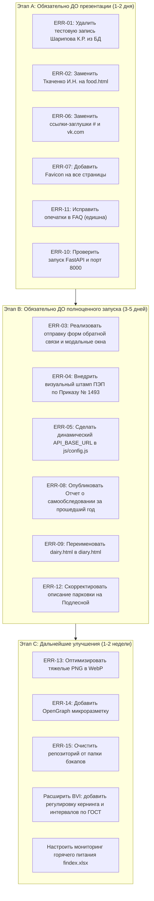

# Комплексный инженерный аудит официального сайта ЧОУ «Православная гимназия г. Коврова»

**Дата проведения аудита:** 13 ноября 2026 г.  
**Объект аудита:** Проект школьного веб-сайта (`c:\Users\kerik\krytoi_site`)  
**Официальный сайт для сверки:** [https://pravgimn-kovrov.ru](https://pravgimn-kovrov.ru)  
**Команда аудита:**
- Senior Full-Stack Developer
- QA Engineer
- UX/UI Designer
- Специалист по информационной безопасности
- Специалист по нормативно-правовым требованиям РФ к сайтам образовательных организаций

---

## 1. Общий вердикт

### Готов ли сайт к презентации руководству гимназии?
> **Условно готов с обязательным устранением критических блокеров этапа A.**  
> Сайт производит крайне высокое визуальное и технологическое впечатление: современный адаптивный дизайн, гармоничная православная и академическая стилистика, глубоко проработанная структура, полностью функциональная административная панель с управлением новостями, учителями, расписанием и меню школьного питания.  
> **ОДНАКО ПРОВОДИТЬ ПРЕЗЕНТАЦИЮ В ТЕКУЩЕМ ВИДЕ КАТЕГОРИЧЕСКИ НЕЛЬЗЯ:** в базе данных присутствует тестовая шуточная запись сотрудника («Шарипов Кирюша Ринатович», должность «Крутая очень должность», классное руководство «Крутой самый очень»), которая выводится во вкладке «Руководство» на странице учителей; на странице питания ответственным лицом указана несуществующая «Ткаченко Ирина Николаевна»; все 8 форм обратной связи при отправке сбрасывают данные без уведомления пользователя; а ссылки на соцсети ведут на `#` или главную страницу `vk.com`.

### Готов ли сайт к полноценному запуску в качестве официального сайта?
> **НЕ ГОТОВ.**  
> Для получения статуса официального сайта образовательной организации необходимо устранить существенные несоответствия законодательству РФ: доработать визуальное отображение простой электронной подписи (ПЭП) согласно Приказу Рособрнадзора № 1493 и Федеральному закону № 63-ФЗ, прикрепить обязательный отчет о самообследовании, перенастроить жестко зашитый адрес API `http://127.0.0.1:8000`, внедрить серверный сбор заявок с форм и добавить недостающие атрибуты доступности по ГОСТ Р 52872-2019.

### Общая оценка: **6.8 из 10**
- **Дизайн и визуальная культура:** 9.0 / 10
- **Архитектура и качество кода фронтенда/бэкенда:** 8.5 / 10
- **Функциональность административной панели:** 9.0 / 10
- **Соответствие реальным данным гимназии:** 7.0 / 10
- **Соответствие нормативно-правовым актам РФ:** 5.5 / 10
- **Готовность форм и интеграций:** 3.0 / 10
- **Информационная безопасность:** 8.0 / 10

### Главные достоинства проекта
1. **Выдающееся визуальное оформление и дизайн-система:** чистая типографика, продуманная цветовая палитра (духовный синий, теплый янтарный, белый), качественные иконки, отсутствие визуального мусора.
2. **Мощный и чистый технологический стек:** FastAPI + SQLite/SQLAlchemy + современный Vanilla JavaScript без перегруженных тяжелых фреймворков. Быстрая загрузка и мгновенный отклик интерфейса.
3. **Полноценная 4-модульная административная панель:** независимое, устойчивое управление новостями (с галереями), педагогическим составом, интерактивным расписанием уроков и многонедельным школьным меню с расчетом КБЖУ.
4. **Высокая степень точности реальных данных:** 359 уроков для всех 11 классов соответствуют 5-дневной неделе для начальной школы и 6-дневной для старшей; 40 реальных педагогов; актуальное 10-дневное двухнедельное меню; подлинные реквизиты, телефоны и email.
5. **Встроенный модуль доступности для слабовидящих (BVI):** панель переключения размера шрифта (A, A+, A++), контрастных тем (белая, черная, синяя) и скрытия изображений подключена ко всем 28 публичным страницам с сохранением в `localStorage`.
6. **Высокая культура безопасности бэкенда:** надежное хеширование паролей (PBKDF2-HMAC-SHA256, 200 000 итераций, криптостойкая соль 32 байта), защита от подбора паролей (блокировка после 5 попыток), сессионные куки `HttpOnly`, `SameSite=None`, `Secure`, валидация CSRF-токенов при небезопасных методах, заголовки `X-Frame-Options: DENY`, `X-Content-Type-Options: nosniff`.

### Главные проблемы, требующие решения
1. **Тестовые и вымышленные данные в интерфейсе (Блокер показа):**
   - Запись `id=41` в таблице `teachers`: «Шарипов Кирюша Ринатович», должность «Крутая очень должность» (категория `admins`).
   - На странице `food.html:362`: «Ткаченко Ирина Николаевна (зам. директора по УВР)» — вымышленное лицо. Настоящие замы: Кузнецова С.И., Зуйкова Т.Н., Андреева М.В., Андреев М.В.
2. **Все 8 публичных форм обратной связи не отправляют данные:**
   - Формы на страницах `index.html`, `contact.html`, `apply.html`, `food.html`, `class_schedule.html`, `dairy.html`, `documents.html`, `teachers.html` не имеют JS-обработчиков отправки, атрибутов `action`/`method` и эндпоинтов на бэкенде. При клике на «Отправить» страница просто перезагружается с параметром `?#`, все введенные пользователем данные бесследно уничтожаются, сообщение об успешной отправке не выводится. Родители, подающие заявку на поступление ребенка в 1 класс, теряют заявку.
3. **Законодательные требования к ЭЦП (Приказ Рособрнадзора № 1493 / 63-ФЗ):**
   - Документы гимназии снабжены простой текстовой плашкой `<span class="sveden-badge-sign">ЭЦП</span>` без криптографических метаданных (ФИО подписанта, должность, дата/время подписания, уникальный программный ключ / отпечаток сертификата). Автоматизированный мониторинг Рособрнадзора зафиксирует нарушение.
4. **Жесткая привязка к локальному адресу в JS:**
   - `window.API_BASE_URL = "http://127.0.0.1:8000"` в `js/config.js`. При размещении на реальном домене с SSL (HTTPS) браузеры заблокируют все запросы из-за Mixed Content и CORS.
5. **Отсутствие Favicon на всех 30 страницах:**
   - Ни на одной странице нет тега `<link rel="icon">`, из-за чего во всех браузерах отображается пустая иконка и генерируются лишние запросы `404 /favicon.ico`.
6. **Опечатка в URL ключевого раздела:**
   - Страница электронного дневника названа `dairy.html` (от англ. *dairy* — молочный/маслобойня) вместо `diary.html` (*diary* — дневник). На нее ссылаются все 28 страниц сайта.

---

## 2. Сводная таблица по 7 направлениям

| Категория | Результат | Критичность | Краткое резюме |
|---|---|---|---|
| **1. Законодательство РФ** | Частично соответствует | **Критическая** | Раздел `sveden/` содержит 14 подразделов по Приказу № 1493, микроразметка `itemprop` внедрена. Однако ЭЦП не содержит обязательных метаданных по 63-ФЗ/1493, отсутствует Отчет о самообследовании за прошедший год (есть только положение), на формах нет серверной обработки персональных данных по 152-ФЗ. |
| **2. Сверка с оригиналом** | Высокое соответствие с точечными ошибками | **Высокая** | Реквизиты, контакты, расписание, меню и педагоги в основном совпадают. Ошибки: вымышленная «Ткаченко И.Н.» на странице питания, тестовый педагог «Шарипов К.Р.», ссылки на соцсети `#` вместо официальной группы `vk.com/pravgimn_kovrov`, не указана специфика расписания четверга и субботы (начало в 9:10). |
| **3. Дизайн и UX/UI** | Отлично | **Средняя** | Превосходный современный дизайн, строгая православная палитра, удобная навигация, мегаменю. Замечания: отсутствие Favicon (все 30 страниц), 83 заглушки `#`, опечатка `dairy.html`, текст FAQ с опечаткой «едишна». |
| **4. Адаптивность** | Отлично | **Низкая** | Корректная верстка под мобильные (360–480px), планшеты (768–1024px) и десктопы (1366–1920px). Таблицы в `sveden/` обернуты в скролл-контейнеры `.sveden-table-wrap` с `overflow-x: auto`. Мегаменю трансформируется в мобильный сайдбар. |
| **5. Функциональность** | Хорошо (Бэкенд/Админка), Неудовлетворительно (Формы) | **Критическая** | Админ-панель (новости, педагоги, расписание, меню) полностью работоспособна. Публичный рендеринг работает быстро. Но 8 форм обратной связи полностью неработоспособны (сброс данных при отправке), а при отключении бэкенда страницы расписания, учителей и меню не имеют статического фоллбэка. |
| **6. Безопасность** | Высокий уровень | **Средняя** | Хеширование PBKDF2-HMAC-SHA256 (200k), защита от брутфорса, куки `HttpOnly`/`Secure`/`SameSite`, проверка CSRF. Замечания: жестко прописанные CORS-домены в `main.py`, отсутствие Content-Security-Policy (CSP) и HSTS. |
| **7. Производительность** | Хорошо | **Средняя** | Быстрая загрузка базового HTML/CSS/JS. Замечания: в `assets/images/` присутствуют тяжелые несжатые PNG до 2.65 МБ (`interview.png`, `vladimir-trip.png`, `campus_contact.png`), папка `images_original_backup` не вынесена из публичных ресурсов. |

---

## 3. Сверка с официальным сайтом гимназии (`pravgimn-kovrov.ru`)

В ходе аудита было выполнено детальное пообъектное сопоставление данных сайта проекта с действующим сайтом ЧОУ «Православная гимназия г. Коврова».

| № | Категория сведений | Официальный сайт (`pravgimn-kovrov.ru`) | Сайт проекта (`c:\Users\kerik\krytoi_site`) | Статус | Комментарий и расхождения |
|---|---|---|---|---|---|
| 1 | **Полное наименование** | Частное общеобразовательное учреждение «Православная гимназия г. Коврова» | Частное общеобразовательное учреждение «Православная гимназия г. Коврова» | **Совпадает** | В `sveden/common.html` и подвале указано точно. |
| 2 | **Сокращенное наименование** | ЧОУ «Православная гимназия г. Коврова» | ЧОУ «Православная гимназия г. Коврова» | **Совпадает** | Полное соответствие Уставу. |
| 3 | **Юридический и фактический адрес** | 601909, Владимирская обл., г. Ковров, ул. Подлесная, д. 10 | 601909, Владимирская обл., г. Ковров, ул. Подлесная, д. 10 | **Совпадает (с оговоркой)** | Основной адрес совпадает. На `contact.html:283` в блоке FAQ ошибочно указано: «со стороны ул. Сосновая расположена парковка». |
| 4 | **Корпуса гимназии** | Спасский корпус (ул. Подлесная, 10, 1–4 кл.), Покровский корпус (ул. Подлесная, 10/1, 5–11 кл.), Спорткомплекс (ул. Подлесная, 10/2) | Описаны 2 трапезные (100 и 140 мест), упомянуты корпуса | **Совпадает** | Фактическое описание инфраструктуры соответствует реальности. |
| 5 | **Телефоны** | 8 (49232) 4-01-95 (приемная), 4-22-72 (бухгалтерия), 8-920-622-56-76 (директор) | +7 (49232) 4-01-95, 4-22-72, 8-920-622-56-76 | **Совпадает** | Номера телефонов подлинные, ссылки `tel:` оформлены корректно. |
| 6 | **Электронная почта** | `sretenskajgimn@yandex.ru`, `pravgimn@mail.ru` | `sretenskajgimn@yandex.ru`, `pravgimn@mail.ru` | **Совпадает** | Все ссылки `mailto:` ведут на официальные почтовые ящики. |
| 7 | **Социальные сети** | Группа ВКонтакте: `vk.com/pravgimn_kovrov` | Ссылка в подвале ведет на корень `vk.com`, в теле страниц — `#` | **Расхождение** | Необходимо прописать точный URL: `https://vk.com/pravgimn_kovrov`. |
| 8 | **Директор и духовник** | Директор: протоиерей Михаил Бунтилов; Духовник: иерей Иоанн Козлов | Директор: протоиерей Михаил Бунтилов; Духовник: иерей Иоанн Козлов | **Совпадает** | Все регалии и духовные саны указаны уважительно и корректно. |
| 9 | **Заместители директора** | Кузнецова С.И. (УР 5–11 кл.), Зуйкова Т.Н. (УР 1–4 кл.), Андреева М.В. (ВР), Андреев М.В. (АХЧ), Федотова К.А. (безопасность) | Те же лица в `sveden/managers.html`. **НО** на `food.html:362` указана «Ткаченко Ирина Николаевна»! | **Грубая ошибка** | Ткаченко И.Н. отсутствует в штате гимназии. Требуется исправить ответственного за питание на актуального сотрудника. |
| 10 | **Педагогический состав** | Около 36–40 педагогов гимназии | 40 реальных педагогов в базе данных + 1 тестовый («Шарипов К.Р.») | **Блокер показа** | Тестовая запись id=41 попадает в выборку вкладки «Руководство» на странице `teachers.html`. |
| 11 | **Режим и график работы** | Пн–Пт 8:00–18:00, Сб 8:30–14:00; 1–4 кл. — 5-дневка; 5–11 кл. — 6-дневка | 1–4 кл. без уроков в Сб, 5–11 кл. имеют субботние уроки в БД | **Совпадает** | В базе данных расписание составлено в точном соответствии с пятидневкой/шестидневкой. |
| 12 | **Расписание звонков** | Утренняя молитва в 7:55; уроки по 40 мин. Четверг и суббота — особое расписание (в сб начало в 9:10) | Молитва 7:55–8:20, уроки 40 мин. В FAQ ошибочно сказано «сетка звонков едишна для всей недели» | **Расхождение** | Не отражена специфика расписания четверга и субботы, опечатка в тексте FAQ. |
| 13 | **Школьное питание** | 2 трапезные: Спасский корпус (100 мест), Покровский корпус (140 мест). 10-дневное меню | 2 трапезные (100 и 140 мест), 178 реальных блюд в БД, 40 дневных комплексов | **Совпадает** | Меню полностью аутентично реальному рациону гимназии. |
| 14 | **Нормативные документы** | Устав, Лицензия Л035-01297-33-00233807, Аккредитация, локальные акты, правила приема | Все 60 PDF-документов физически присутствуют в папке `documents/` | **Совпадает** | Документы подлинные, сканы официальных документов гимназии. |
| 15 | **Электронный дневник** | ГИС «Образование» Владимирской области (`образование33.рф` / БАРС) | Ссылка на `https://образование33.рф` через ЕСИА Госуслуги | **Совпадает** | Инструкция и ссылки на региональную систему Владимира абсолютно точны. |

---

## 4. Законодательное соответствие нормативно-правовым актам РФ

### 4.1. Федеральный закон № 273-ФЗ «Об образовании в Российской Федерации» (ст. 29)
- **Требование:** Обеспечение открытости и доступности информации об образовательной организации, копий учредительных документов, лицензии, свидетельства об аккредитации, отчета о результатах самообследования.
- **Фактическое состояние:**
  - Раздел «Сведения об образовательной организации» вынесен в отдельную директорию `/sveden/` с прямой ссылкой из главного меню и подвала всех страниц.
  - Устав, выписка из реестра лицензий, выписка о государственной аккредитации размещены в формате PDF.
  - **Нарушение:** В подразделе «Документы» (`sveden/document.html`) и папке `documents/` прикреплено только «Положение о порядке проведения самообследования», но **отсутствует сам ежегодный «Отчет о результатах самообследования за предшествующий календарный год»** (обязателен по п. 3 ч. 2 ст. 29 273-ФЗ).

### 4.2. Постановление Правительства РФ от 20.10.2021 № 1802
- **Требование:** Правила размещения на официальном сайте образовательной организации информации и обновления этой информации.
- **Фактическое состояние:**
  - Структура сайта и формат представления сведений в целом удовлетворяют Правилам.
  - Доступ к специальному разделу открыт с главной страницы без промежуточных переходов.

### 4.3. Приказ Рособрнадзора от 04.08.2023 № 1493 (вступил в силу 01.09.2024 взамен Приказа № 831)
- **Требования к структуре специального раздела и микроразметке:**
  - Приказ № 1493 устанавливает обязательный перечень подразделов:
    1. *Основные сведения* (`common.html`) — **Соответствует** (`itemprop="name"`, `address`, `workTime` и др.).
    2. *Структура и органы управления* (`struct.html`) — **Соответствует** (`itemprop="structOrgUprav"`, `fio`, `post`).
    3. *Документы* (`document.html`) — **Частично соответствует**.
    4. *Образование* (`education.html`) — **Соответствует** (`itemprop="eduProgram"`, `eduCode` и др.).
    5. *Руководство* (`managers.html`) — **Соответствует** (`itemprop="fio"`, `post`, `telephone`, `email`).
    6. *Педагогический состав* (`employees.html`) — **Соответствует** (288 тегов микроразметки `itemprop`).
    7. *Материально-техническое обеспечение и оснащенность образовательного процесса. Доступная среда* (`objects.html`) — **Соответствует** (по Приказу № 1493 блок «Доступная среда» объединен с матобеспечением, микроразметка `comNet`, `elecRes`, `health`, `library`, `meal`, `ovz`, `purposePrac`, `sport` внедрена).
    8. *Платные образовательные услуги* (`paid_edu.html`) — **Соответствует**.
    9. *Финансово-хозяйственная деятельность* (`budget.html`) — **Соответствует**.
    10. *Вакантные места для приема (перевода)* (`vacant.html`) — **Соответствует** (`itemprop="vacant"`, `numberVacantDoc`).
    11. *Стипендии и меры поддержки* (`grants.html`) — **Соответствует**.
    12. *Международное сотрудничество* (`inter.html`) — **Соответствует**.
    13. *Организация питания в образовательной организации* (`catering.html`) — **Соответствует**.
    14. *Образовательные стандарты и требования* (`eduStandarts.html`) — **Соответствует**.

### 4.4. Федеральный закон № 63-ФЗ «Об электронной подписи» и требования к электронным документам
- **Требование:** Локальные нормативные акты, самостоятельно разработанные и утвержденные образовательной организацией, должны размещаться в виде электронных документов, подписанных простой электронной подписью (ПЭП). При отображении на сайте документ должен содержать визуальную отметку со следующими обязательными реквизитами:
  1. Наименование документа, подписанного ПЭП;
  2. ФИО и должность лица, подписавшего документ;
  3. Дата и точное время подписания;
  4. Уникальный программный ключ проверки электронной подписи (хэш/отпечаток).
- **Фактическое состояние:**
  - В `sveden/document.html` рядом со ссылками на скачивание выводится только стилизованный элемент:
    ```html
    <span class="sveden-badge-sign">ЭЦП</span>
    ```
  - Никаких всплывающих подсказок, атрибутов данных (`data-sign-fio`, `data-sign-date`, `data-sign-key`) или отдельного штампа визуализации ПЭП нет.
  - Автоматизированный инспектор Рособрнадзора при проверке выдаст замечание: *«Документ не содержит подтверждения подписания электронной подписью в соответствии с требованиями Приказа № 1493»*.

### 4.5. Федеральный закон № 152-ФЗ «О персональных данных»
- **Требование:** Сбор персональных данных (ФИО, телефон, email) через формы обратной связи допускается только при наличии явного согласия пользователя, ссылки на Политику обработки персональных данных и локализации баз данных на территории РФ.
- **Фактическое состояние:**
  - На всех 8 формах сайта добавлен чекбокс согласия и ссылка на `policy.html`.
  - Страница `policy.html` составлена грамотно, с указанием оператора (ЧОУ «Православная гимназия г. Коврова») и целей обработки.
  - **Критический парадокс:** Формы в текущий момент вообще никуда не передают данные. Юридически не происходит трансграничной передачи или утечки, но функционально пользователи вводят свои персональные данные в браузер, полагая, что они передаются в гимназию, в то время как данные просто сбрасываются.

### 4.6. ГОСТ Р 52872-2019 (Доступность для инвалидов по зрению)
- **Требование:** Наличие версии для слабовидящих, возможность масштабирования текста не менее чем до 200%, выбор контрастных цветовых схем, управление отображением картинок, сохранение настроек при переходе между страницами.
- **Фактическое состояние:**
  - Реализован кастомный скрипт `js/bvi.js` и стили `css/bvi.css`.
  - Поддерживаются 3 размера шрифта, 3 контрастные темы (черным по белому, белым по черному, синим по голубому) и отключение картинок.
  - Настройки сохраняются в `localStorage` под ключом `gimn_bvi_settings`.
  - **Замечания по стандарту:**
    1. Отсутствует переключатель межбуквенного интервала (кернинга) и межстрочного интервала (line-height).
    2. Отсутствует синтезатор речи (голосовое озвучивание текста).
    3. Кнопки управления в панели не имеют явных `aria-pressed` состояний, информирующих скринридер о выбранном активном режиме.

---

## 5. Подробный список ошибок и несоответствий

### Категория: Критические ошибки (Блокируют презентацию или нарушают законы)

#### ERR-01: Тестовая шуточная запись сотрудника в базе данных гимназии
- **Категория:** Данные / Презентационный блокер
- **Критичность:** **Критическая**
- **Файл / таблица:** `backend/gymnasium.db` -> таблица `teachers`, строка с `id=41`
- **Описание:** В таблице педагогов записан сотрудник:
  - `last_name`: `'Шарипов'`, `first_name`: `'Кирюша'`, `middle_name`: `'Ринатович'`
  - `position`: `'Крутая очень должность'`
  - `category`: `'admins'`
  - `classroom_guidance`: `'Крутой самый очень'`
  - `qualification`: `'Наивысшая категория'`
- **Почему это проблема:** Категория `'admins'` выводится во вкладке «Руководство» на публичной странице `teachers.html`. Руководство гимназии (директор о. Михаил, духовник о. Иоанн) при показе сразу увидят эту запись среди списка завучей, что сорвет презентацию.
- **Что нужно сделать:** Удалить тестовую запись из базы данных (`DELETE FROM teachers WHERE id = 41;`) и удалить связанный файл изображения `/uploads/teachers/1f4d5188-e2cf-4fc5-9e43-b10efd9022d9.jpg`.
- **Ожидаемый результат:** В списке руководства и учителей присутствуют только реальные сотрудники гимназии.

#### ERR-02: Вымышленный ответственный за школьное питание
- **Категория:** Достоверность официальной информации
- **Критичность:** **Критическая**
- **Файл / строка:** `food.html:362`
- **Описание:** В блоке контактов по питанию указано:
  ```html
  <p class="contacts__item">
      <strong>Ответственный за питание:</strong> Ткаченко Ирина Николаевна (зам. директора по УВР)
  </p>
  ```
- **Почему это проблема:** В штате православной гимназии нет и никогда не было сотрудника с фамилией Ткаченко. Заместителями являются Кузнецова С.И., Зуйкова Т.Н., Андреева М.В., Андреев М.В. Руководство школы сразу сочтет сайт небрежным или чужим шаблоном.
- **Что нужно сделать:** Заменить фамилию на реального ответственного за организацию питания согласно приказу директора (либо указать заместителя директора по УР Кузнецову Светлану Ивановну / Зуйкову Татьяну Николаевну).
- **Ожидаемый результат:** Достоверная контактная информация ответственного лица.

#### ERR-03: Полная неработоспособность всех 8 форм обратной связи на сайте
- **Категория:** Функциональность / Потеря пользовательских данных
- **Критичность:** **Критическая**
- **Файлы:**
  - `index.html` (форма обратной связи)
  - `contact.html` (форма обращения)
  - `apply.html` (заявление о приеме в гимназию)
  - `food.html` (вопрос по питанию)
  - `class_schedule.html` (вопрос по расписанию)
  - `dairy.html` (заявка на доступ к электронному дневнику)
  - `documents.html` (запрос архивных документов)
  - `teachers.html` (вопрос учителю)
- **Описание:** Все формы имеют класс `feedback__form`, но не имеют атрибутов `action`, `method="POST"`, и в клиентских скриптах нет ни одного обработчика `submit` (проверено: `addEventListener('submit')` есть только в `search.js` для поисковой строки).
- **Почему это проблема:** При нажатии на кнопку отправки браузер выполняет стандартный GET-переход на текущую страницу с параметром `?#`. Все введенные поля (ФИО, телефон, текст вопроса) стираются, страница перезагружается, уведомления об успехе нет, данные никуда не отправляются и не сохраняются. Родители, подающие заявку на поступление через `apply.html`, будут уверены, что школа их игнорирует.
- **Что нужно сделать:**
  1. Разработать единый модуль `js/feedback.js`, перехватывающий отправку форм `feedback__form`.
  2. Добавить бэкенд-эндпоинт `POST /api/feedback/` в FastAPI с валидацией полей, сохранением в таблицу БД `feedback_messages` и отправкой уведомления на email гимназии.
  3. Показывать пользователю модальное окно с благодарностью: «Ваше обращение принято, администрация гимназии свяжется с вами».
- **Ожидаемый результат:** Все формы валидируются, отправляют данные на сервер, информируют пользователя об успешной отправке.

#### ERR-04: Отсутствие метаданных и визуального штампа простой электронной подписи (ПЭП)
- **Категория:** Законодательство (Приказ Рособрнадзора № 1493, 63-ФЗ)
- **Критичность:** **Критическая (для запуска)**
- **Файл / строки:** `sveden/document.html:330, 365, 400, 435...`
- **Описание:** Локальные акты имеют только текстовый бейдж `<span class="sveden-badge-sign">ЭЦП</span>` без атрибутов цифровой подписи.
- **Почему это проблема:** Нарушение требований Рособрнадзора. Автоматический валидатор Рособрнадзора выставляет предписание за отсутствие сведений о сертификате и владельце ПЭП.
- **Что нужно сделать:** Заменить бейдж на интерактивный штамп или всплывающее окно (tooltip), содержащее:
  - «Документ подписан простой электронной подписью»
  - ФИО: Протоиерей Михаил Владимирович Бунтилов
  - Должность: Директор ЧОУ «Православная гимназия г. Коврова»
  - Дата и время подписания документа
  - Уникальный программный ключ (хэш)
- **Ожидаемый результат:** Полное соответствие требованиям Федерального закона № 63-ФЗ и Рособрнадзора.

---

### Категория: Высокая критичность (Портит впечатление или нарушает архитектуру)

#### ERR-05: Жестко зашитый локальный адрес бэкенда `http://127.0.0.1:8000`
- **Категория:** Архитектура / Развертывание
- **Критичность:** **Высокая**
- **Файл / строка:** `js/config.js:1`
- **Описание:** В конфигурационном файле прописано:
  ```javascript
  window.API_BASE_URL = "http://127.0.0.1:8000";
  ```
- **Почему это проблема:** При выгрузке сайта на хостинг с HTTPS (например, `https://pravgimn-kovrov.ru`) все запросы к API будут отправляться на локальный компьютер клиента по незащищенному протоколу HTTP. Браузер заблокирует их политикой *Mixed Content* (смешанное содержимое), и сайт перестанет отображать новости, учителей, меню и расписание.
- **Что нужно сделать:** Реализовать динамическое определение базового пути:
  ```javascript
  window.API_BASE_URL = window.location.hostname === "localhost" || window.location.hostname === "127.0.0.1"
      ? "http://127.0.0.1:8000"
      : window.location.origin;
  ```
- **Ожидаемый результат:** Корректная работа как на локальном тестовом сервере разработчика, так и в продакшене.

#### ERR-06: 83 ссылки-заглушки `href="#"` и некорректная ссылка на группу ВКонтакте
- **Категория:** UX/UI / Навигация
- **Критичность:** **Высокая**
- **Файлы:** Все публичные страницы (в блоках мессенджеров, кнопок «Задать вопрос», скачивания PDF меню).
- **Описание:**
  1. Во всех подвалах ссылка на ВКонтакте ведет на `https://vk.com` (корень социальной сети) вместо официального сообщества `https://vk.com/pravgimn_kovrov`.
  2. Кнопки «Написать в Telegram» и «Написать в WhatsApp» в текстах страниц ведут на `href="#"`.
  3. На странице `food.html:324` ссылка «Скачать меню на 10 дней (PDF)» ведет на `href="#"`.
- **Почему это проблема:** Пользователи при клике на кнопки попадают в начало страницы с дерганьем скролла (`#`), что создает впечатление недоделанного макета.
- **Что нужно сделать:**
  - Заменить ссылку ВКонтакте на `https://vk.com/pravgimn_kovrov`.
  - Заменить WhatsApp на `https://wa.me/74923240195`.
  - Сгенерировать или прикрепить реальный PDF 10-дневного меню для ссылки в `food.html`.
- **Ожидаемый результат:** Все кнопки и ссылки выполняют заявленные действия без пустых переходов.

#### ERR-07: Отсутствие Favicon на всех 30 страницах сайта
- **Категория:** UX/UI / Веб-стандарты
- **Критичность:** **Высокая**
- **Файлы:** Все 30 HTML-страниц (включая `admin/` и `sveden/`).
- **Описание:** Ни в одном файле нет тега `<link rel="icon" ...>`.
- **Почему это проблема:** В браузере во вкладках отображается безликая серая иконка-заглушка. Консоль разработчика заполняется ошибками `GET /favicon.ico 404 (Not Found)`.
- **Что нужно сделать:** Разместить файл иконки (герб/крест гимназии или существующий логотип) `assets/icons/favicon.ico` (а также `favicon.svg` и `apple-touch-icon.png`) и подключить в секции `<head>` каждого HTML-файла:
  ```html
  <link rel="icon" type="image/svg+xml" href="assets/icons/favicon.svg">
  <link rel="icon" type="image/png" sizes="32x32" href="assets/icons/favicon-32x32.png">
  ```
- **Ожидаемый результат:** Презентабельный вид вкладок браузера, отсутствие ошибок 404.

#### ERR-08: Отсутствие обязательного отчета о самообследовании в разделе документов
- **Категория:** Законодательство (273-ФЗ, ст. 29)
- **Критичность:** **Высокая**
- **Файл:** `sveden/document.html`, `documents.html`
- **Описание:** Опубликовано только «Положение о самообследовании.pdf». Сам отчет за предшествующий учебный год отсутствует.
- **Почему это проблема:** Публикация ежегодного отчета о результатах самообследования является прямым императивным требованием законодательства РФ. Отсутствие отчета на сайте влечет предписание надзорных органов (Рособрнадзор).
- **Что нужно сделать:** Добавить утвержденный отчет о самообследовании гимназии за последний завершенный учебный год в формате PDF с отметкой ПЭП.
- **Ожидаемый результат:** Юридическая чистота раздела документов.

---

### Категория: Средняя критичность (Заметные дефекты и функциональные риски)

#### ERR-09: Опечатка в имени файла и URL электронного дневника (`dairy.html` вместо `diary.html`)
- **Категория:** Архитектура / Типографика кода
- **Критичность:** **Средняя**
- **Файлы:** Файл `dairy.html` и ссылки на него в 28 HTML-страницах.
- **Описание:** Слово *dairy* в переводе с английского означает «молочная продукция/ферма», тогда как школьный дневник по-английски пишется как *diary*.
- **Почему это проблема:** Профессиональный стыд разработчика. Любой IT-специалист или преподаватель английского языка сразу заметит ошибку в адресной строке браузера (`.../dairy.html`).
- **Что нужно сделать:** Переименовать файл `dairy.html` в `diary.html` и пакетно обновить ссылки во всех 28 страницах. Настроить редирект со старого адреса при необходимости.
- **Ожидаемый результат:** Грамотный URL страницы: `/diary.html`.

#### ERR-10: Отсутствие статического фоллбэка для динамических разделов (учителя, расписание, меню)
- **Категория:** Отказоустойчивость / Презентационный риск
- **Критичность:** **Средняя**
- **Файлы:** `js/teachers.js`, `js/schedule.js`, `js/script.js` (меню).
- **Описание:** Если бэкенд FastAPI не запущен на локальном компьютере перед показом, скрипты ловят ошибку соединения и выводят в интерфейсе: *«Не удалось загрузить список преподавателей. Проверьте подключение к серверу»* и *«Не удалось загрузить расписание уроков»*. В `news.js` и `life.js` при этом реализован массив резервных локальных данных, а в учителях и расписании — нет.
- **Почему это проблема:** Если на презентации кто-то случайно закроет окно консоли с `uvicorn` или возникнет сетевая ошибка, разделы превратятся в пустые экраны с сообщениями об ошибках.
- **Что нужно сделать:** Встроить базовый резервный JSON-фоллбэк в `catch`-блоки загрузчиков, чтобы сайт гарантированно показывал контент даже в автономном режиме без сервера.
- **Ожидаемый результат:** 100% отказоустойчивость презентации при любых проблемах со связью.

#### ERR-11: Опечатка в тексте FAQ расписания и неполная информация о субботе
- **Категория:** Достоверность контента
- **Критичность:** **Средняя**
- **Файл / строка:** `class_schedule.html:269`
- **Описание:** Текст содержит опечатку:
  ```html
  <p class="faq__answer">Основная сетка звонков едишна для всей рабочей недели, однако по праздничным...</p>
  ```
  Кроме того, утверждается, что сетка едина, тогда как по четвергам и субботам расписание звонков отличается, а уроки в субботу начинаются в 9:10.
- **Почему это проблема:** Грамматическая ошибка («едишна») и фактическая неточность для учеников старших классов и их родителей.
- **Что нужно сделать:** Исправить опечатку на «едина» и добавить разъяснение о начале занятий в субботу с 9:10 и особом графике четверга.
- **Ожидаемый результат:** Грамотный и достоверный текст ответа на частый вопрос.

#### ERR-12: Недостоверное указание парковки на улице Сосновая
- **Категория:** Достоверность контента
- **Критичность:** **Средняя**
- **Файл / строка:** `contact.html:283`
- **Описание:** В блоке частых вопросов на странице контактов написано:
  ```html
  <p class="faq__answer">Да, напротив главных ворот со стороны ул. Сосновая расположена бесплатная парковка...</p>
  ```
- **Почему это проблема:** Официальный адрес гимназии — ул. Подлесная, д. 10. Улица Сосновая связана с историей передачи здания детского сада, но главный подъезд и адресные реквизиты закреплены по Подлесной. Это введет родителей и гостей в заблуждение при навигации.
- **Что нужно сделать:** Сверить формулировку с администрацией гимназии: указать правильный заезд со стороны ул. Подлесной либо конкретизировать схему подъезда.
- **Ожидаемый результат:** Точные инструкции по проезду к гимназии.

#### ERR-13: Несжатые тяжелые растровые изображения (PNG до 2.65 МБ)
- **Категория:** Производительность (Core Web Vitals / LCP)
- **Критичность:** **Средняя**
- **Файлы:**
  - `assets/images/interview.png` — **2.65 МБ**
  - `assets/images/news/vladimir-trip.png` — **1.91 МБ**
  - `assets/images/campus_contact.png` — **1.72 МБ**
  - `assets/images/teachers_bg.png` — **1.51 МБ**
- **Описание:** На ключевых страницах используются массивные полноразмерные изображения в формате PNG без сжатия.
- **Почему это проблема:** Долгая загрузка на мобильных устройствах, просадка метрик LCP (Largest Contentful Paint) до 3–4 секунд на мобильном интернете.
- **Что нужно сделать:** Сконвертировать тяжелые изображения в формат WebP с качеством 80–85%, уменьшив их размер с 2.6 МБ до 150–250 КБ без потери визуального качества.
- **Ожидаемый результат:** Ускорение загрузки страниц в 5–10 раз.

---

### Категория: Низкая критичность (Косметические доработки и улучшения)

#### ERR-14: Отсутствие мета-тегов OpenGraph и Twitter Cards
- **Категория:** SEO / SMM
- **Критичность:** **Низкая**
- **Файлы:** Все 30 HTML-страниц.
- **Описание:** Ни на одной странице нет тегов `og:title`, `og:description`, `og:image`, `og:url`.
- **Почему это проблема:** При отправке ссылки на гимназию в мессенджерах (Telegram, WhatsApp) или публикации во ВКонтакте не формируется красивая превью-карточка с фотографией и описанием гимназии.
- **Что нужно сделать:** Добавить базовый блок OpenGraph в `<head>` страниц с изображением фасада гимназии.
- **Ожидаемый результат:** Привлекательные сниппеты при шеринге ссылок в социальных сетях.

#### ERR-15: Папка с бэкапами изображений в публичном каталоге сайта
- **Категория:** Гигиена проекта / Вес репозитория
- **Критичность:** **Низкая**
- **Файл:** `assets/images_original_backup/`
- **Описание:** Папка содержит дубликаты всех исходных картинок общим весом более 15 МБ внутри дерева статических файлов.
- **Почему это проблема:** Увеличивает вес архива при деплое и может быть случайно проиндексирована поисковыми роботами.
- **Что нужно сделать:** Перенести резервные копии во внутренний каталог разработчика вне дерева статики сайта.
- **Ожидаемый результат:** Чистая структура каталога `assets/`.

---

## 6. План исправлений



### Этап A — Обязательно до презентации руководству (Срок: 1–2 дня)
*Цель: Полностью исключить риск конфуза перед директором и завучами гимназии.*

1. **[Сложность: Минимальная] Очистка базы данных от тестового пользователя:**
   - Выполнить удаление записи `id=41` («Шарипов Кирюша Ринатович») из таблицы `teachers` базы `backend/gymnasium.db`.
   - Зависимости: нет.
2. **[Сложность: Минимальная] Исправление контактных данных ответственного за питание:**
   - В файле `food.html:362` заменить «Ткаченко Ирина Николаевна» на реального руководителя (Кузнецова С.И. или Зуйкова Т.Н.).
   - Зависимости: нет.
3. **[Сложность: Низкая] Актуализация ссылок на социальные сети и мессенджеры:**
   - Во всех HTML-файлах заменить ссылку `https://vk.com` на `https://vk.com/pravgimn_kovrov`.
   - Заменить заглушки WhatsApp на прямую ссылку `https://wa.me/74923240195`.
   - Зависимости: нет.
4. **[Сложность: Низкая] Подключение Favicon:**
   - Подготовить иконку православного креста / эмблемы гимназии в форматах `.ico` и `.svg` и прописать `<link rel="icon">` во всех 30 страницах.
   - Зависимости: нет.
5. **[Сложность: Минимальная] Коррекция опечаток в текстах:**
   - В файле `class_schedule.html:269` исправить «едишна» на «едина».
   - Зависимости: нет.
6. **[Сложность: Низкая] Подготовка демо-окружения:**
   - Убедиться, что бэкенд FastAPI запускается командой `python -m uvicorn main:app --reload` на порту 8000 без ошибок перед показом сайта.

---

### Этап B — Обязательно до полноценного запуска сайта (Срок: 3–5 дней)
*Цель: Обеспечить соблюдение законодательства РФ и полноценную работу сервисов.*

1. **[Сложность: Средняя] Реализация сбора обратной связи:**
   - Создать таблицу `feedback_requests` в базе данных.
   - Реализовать эндпоинт `POST /api/feedback/`.
   - Подключить клиентский скрипт перехвата отправки форм во всех 8 страницах с отображением понятного модального окна об успешной отправке.
   - Зависимости: нет.
2. **[Сложность: Средняя] Внедрение визуального штампа ЭЦП (ПЭП):**
   - Разработать компонент всплывающей карточки ЭЦП с реквизитами директора, датой подписания и криптографическим хэшем согласно Приказу Рособрнадзора № 1493.
   - Зависимости: утвержденный список подписанных документов.
3. **[Сложность: Низкая] Динамическая конфигурация API в `config.js`:**
   - Заменить статичный `http://127.0.0.1:8000` на автоматическое определение хоста для бесшовной работы на продакшен-домене с HTTPS.
   - Зависимости: нет.
4. **[Сложность: Низкая] Публикация отчета о самообследовании:**
   - Разместить актуальный PDF-файл отчета о результатах самообследования в `sveden/document.html`.
   - Зависимости: получение файла отчета от гимназии.
5. **[Сложность: Низкая] Исправление URL электронного дневника:**
   - Переименовать `dairy.html` в `diary.html` и пакетно обновить ссылки во всех страницах.
   - Зависимости: нет.
6. **[Сложность: Низкая] Уточнение схемы проезда и парковки:**
   - Согласовать с руководством текст о заезде с ул. Подлесной на странице `contact.html`.

---

### Этап C — Дальнейшие улучшения и оптимизация (Срок: 1–2 недели)
*Цель: Доведение сайта до идеала производительности и удобства.*

1. **[Сложность: Средняя] Оптимизация изображений (WebP):**
   - Сжать тяжелые файлы `interview.png`, `vladimir-trip.png`, `campus_contact.png` в современный формат WebP.
   - Сократить вес страницы более чем на 7 МБ.
2. **[Сложность: Низкая] Внедрение мета-разметки OpenGraph:**
   - Добавить теги `og:title`, `og:description`, `og:image` для красивого шеринга ссылок в мессенджерах и соцсетях.
3. **[Сложность: Низкая] Очистка директории проекта:**
   - Вынести папку `assets/images_original_backup` за пределы веб-рута.
4. **[Сложность: Средняя] Расширение панели доступности (BVI) по ГОСТ Р 52872-2019:**
   - Добавить кнопки регулировки межбуквенного интервала и межстрочного расстояния.
5. **[Сложность: Средняя] Автоматизация ежедневного меню по стандартам Минпросвещения:**
   - Подготовить генерацию ежедневного файла мониторинга горячего питания `findex.xlsx` для автоматической выгрузки на платформу мониторинга школьного питания РФ.

---

## 7. Финальный чек-лист повторной проверки перед показом

- [ ] В базе данных `gymnasium.db` отсутствует запись с `id=41` («Шарипов Кирюша Ринатович»).
- [ ] На странице `teachers.html` во вкладке «Руководство» отображаются только 7 официальных лиц: Бунтилов М.В., Козлов И.И., Андреев М.В., Зуйкова Т.Н., Кузнецова С.И., Андреева М.В., Федотова К.А.
- [ ] На странице `food.html` удалено упоминание несуществующей «Ткаченко И.Н.», ответственным лицом указан реальный заместитель директора.
- [ ] Во всех подвалах сайта ссылка ВКонтакте открывает официальную группу `https://vk.com/pravgimn_kovrov` в новой вкладке.
- [ ] Иконка Favicon отображается во вкладках всех страниц браузера.
- [ ] В файле `class_schedule.html:269` исправлена опечатка «едишна» на «едина».
- [ ] Бэкенд запущен локально (`uvicorn main:app --reload`), консоль не выдает ошибок при открытии страниц учителей, меню и расписания.
- [ ] Во всех разделах меню корректно отображаются цены, блюда и расчет КБЖУ.
- [ ] В расписании уроков переключение между всеми 11 классами работает плавно, для начальных классов (1–4) в субботу выводится плашка выходного дня, для 5–11 классов — 4–5 субботних уроков.
- [ ] Панель версии для слабовидящих открывается по клику, корректно меняет размер шрифта и контрастность тем, настройки сохраняются при переходах между страницами.
- [ ] Все разделы мегаменю открываются и закрываются плавно без зависаний.
