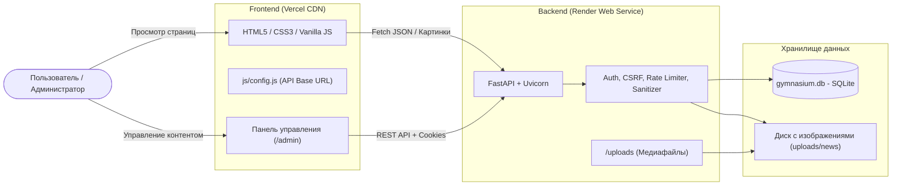

# 🏫 Официальный сайт Православной гимназии г. Коврова

Современный образовательный веб-портал с динамической лентой новостей, полнофункциональной административной панелью, интерактивным поиском, галереями и гибридной архитектурой развёртывания.

---

## 📑 Содержание

1. [Архитектура проекта](#-архитектура-проекта)
2. [Технологический стек](#-технологический-стек)
3. [Ключевые фишки и функционал](#-ключевые-фишки-и-функционал)
4. [Структура репозитория](#-структура-репозитория)
5. [Безопасность](#-безопасность)
6. [API Спецификация](#-api-спецификация)
7. [Установка и локальный запуск](#-установка-и-локальный-запуск)
8. [Развертывание (Production Deployment)](#-развертывание-production-deployment)

---

## 🏛 Архитектура проекта

Проект построен по модели **Decoupled / Headless Architecture**:



* **Frontend:** Статический многостраничный сайт (HTML5, современный CSS3, чистый модульный JavaScript). Хостится на **Vercel** с распределением через CDN для максимальной скорости загрузки.
* **Backend:** RESTful API на **FastAPI** (Python 3.10+). Размещён на **Render.com**. Отвечает за аутентификацию, сессии, хранение новостей и загрузку изображений.
* **База данных:** **SQLite** c ORM **SQLAlchemy**. Хранит администраторов, активные сессии, историю попыток входа, новости и связанные галереи картинок.
* **Хранилище медиа:** Локальное дисковое хранилище на бэкенде с раздачей через статический маунт `/uploads` и генерацией защищённых UUID-имен.

---

## 🛠 Технологический стек

### Frontend
* **Разметка и стили:** Семантический HTML5, CSS3 (CSS Variables, Flexbox, Grid, адаптивная вёрстка для мобильных устройств, БЭМ).
* **Скрипты:** Vanilla JavaScript (ES6+ Modules, Fetch API, Async/Await) — без тяжелых фреймворков для мгновенного отклика.
* **Компоненты UI:** Кастомный Lightbox для просмотра фото, модальные окна, аккордеоны, динамические фильтры категорий, карусели и анимации скролла.

### Backend
* **Язык и фреймворк:** Python 3.10+, **FastAPI**
* **ASGI Сервер:** **Uvicorn**
* **ORM и БД:** **SQLAlchemy 2.0**, **SQLite**
* **Валидация данных:** **Pydantic v2**
* **Обработка медиа:** **Pillow (PIL)** — валидация целостности файлов, проверка реального MIME-типа и конвертация
* **Безопасность и санитайзинг:** **Bleach** (очистка HTML от XSS), **hashlib/hmac/secrets** (PBKDF2-HMAC-SHA256 криптография)

---

## 🌟 Ключевые фишки и функционал

### 1. Интерактивная лента новостей и галереи
* **Динамическая загрузка:** Новости загружаются через API как на главной странице (`index.html`), так и в общем каталоге (`life.html`) и на детальной странице (`news.html?id=...`).
* **Фильтрация по категориям:** Мгновенный фильтр на клиенте (праздники, образование, паломничество и др.).
* **Мульти-галерея и Lightbox:** К каждой новости можно прикрепить неограниченное число фотографий. Полноэкранный просмотр изображений со стрелками переключения, зумом и поддержкой клавиш клавиатуры (`Escape`, `ArrowLeft`, `ArrowRight`).
* **Гибкая обложка:** Администратор может выбрать любую загруженную фотографию в качестве главной обложки новости.

### 2. Сквозной интеллектуальный поиск (`search.html`)
* Полнотекстовый поиск объединяет **статические страницы сайта** (история, расписание, документы, контакты) и **динамические новости из базы данных**.
* Очистка поисковых запросов от HTML-тегов, подсветка совпадений, удобная навигация по результатам.

### 3. Полнофункциональная Админ-панель (`/admin`)
* **Безопасный вход:** Страница логина с защитой от подбора паролей.
* **CRUD новостей:** Создание новостей с форматированным описанием, редактирование текста и категорий, удаление новостей.
* **Управление медиа:** Перетаскивание (Drag & Drop) и мультизагрузка картинок прямо в карточку новости, назначение главной фотографии, удаление отдельных фото.
* **Автоматическая синхронизация сессии:** Проверка `/api/auth/me` при входе в админку с авто-редиректом на форму входа при истечении сессии.

### 4. Разделы сайта
* **Главная (`index.html`):** Приветственный блок, быстрые ссылки, свежие события, контакты.
* **История гимназии (`story_school.html`):** Интерактивная хроника основания и развития гимназии.
* **Жизнь гимназии (`life.html`):** Архив всех событий с фильтрацией по направлениям.
* **Расписание (`class_schedule.html`):** Расписание уроков и звонков.
* **Электронный дневник (`dairy.html`):** Информация об успеваемости и ссылки на внешние журналы.
* **Питание (`food.html`):** Меню, условия льготного питания, документы родительского контроля.
* **Документы (`documents.html`):** Устав, лицензии, локальные нормативные акты.
* **Педагогический состав (`teachers.html`):** Карточки учителей и руководства гимназии.
* **Контакты (`contact.html`):** Схема проезда, телефоны, интерактивные формы обратной связи.
* **Поступление (`apply.html`):** Правила приёма, перечень документов и этапы зачисления.

---

## 🔒 Безопасность

Проект разработан с учетом строгих стандартов веб-безопасности:

1. **Защита паролей администратора:**
   * Хеширование алгоритмом `PBKDF2-HMAC-SHA256` с уникальной криптографической солью (32 байта) и 200 000 раундов хеширования.
2. **Сессии и Cross-Site Cookies:**
   * Сессионные токены генерируются через `secrets.token_urlsafe(32)`.
   * В базе сохраняется только `SHA-256` хеш токена.
   * Куки выставляются с параметрами `HttpOnly=True`, `SameSite=None`, `Secure=True` — это исключает доступ к токену через JavaScript и обеспечивает работу между разными доменами (Vercel фронтенд + Render бэкенд).
3. **Двухфакторная CSRF-защита:**
   * Использование шаблона Double Submit Cookie: бэкенд генерирует криптографический CSRF-токен, передаваемый через куку и проверяемый в заголовке `X-CSRF-Token` для всех изменяющих запросов (`POST`, `PUT`, `DELETE`).
4. **Защита от Brute-Force (Rate Limiting):**
   * Таблица `login_attempts` отслеживает неудачные попытки входа по связке `username + IP`.
   * При достижении 5 неудачных попыток аккаунт/IP временно блокируется на 5 минут с отдачей HTTP 429 (`Retry-After`).
5. **Защита от XSS (Cross-Site Scripting):**
   * Весь входящий HTML в теле новостей фильтруется библиотекой `bleach` по строгому белому списку тегов (`<p>`, `<div>`, `<strong>`, `<a>`, `<ul>` и др.) и безопасных протоколов (`http`, `https`, `mailto`).
6. **Безопасная загрузка файлов:**
   * Проверка размера (до 10 МБ).
   * Проверка структуры изображения через Pillow (`Image.verify()`) — исключает маскировку исполняемых скриптов под картинки.
   * Разрешены только форматы `JPEG`, `PNG`, `WEBP`.
   * Файлы переименовываются в случайные `UUID v4`, предотвращая Directory Traversal атаки.
7. **HTTP Security Headers:**
   * На уровне FastAPI middleware проставляются заголовки: `X-Content-Type-Options: nosniff`, `X-Frame-Options: DENY`, `Referrer-Policy: strict-origin-when-cross-origin`, `Permissions-Policy`.
8. **CORS:**
   * Жёстко ограничен список разрешённых Origin (localhost и домены на Vercel).

---

## 📡 API Спецификация

Базовый путь: `/api`

### Аутентификация (`/api/auth`)
| Метод | Эндпоинт | Доступ | Описание |
|---|---|---|---|
| `GET` | `/api/auth/csrf` | Публичный | Получение CSRF-токена |
| `POST` | `/api/auth/login` | Публичный | Вход администратора (ставит `admin_session` cookie) |
| `POST` | `/api/auth/logout` | Админ | Выход и удаление сессии |
| `GET` | `/api/auth/me` | Админ | Проверка текущей сессии администратора |

### Новости (`/api/news`)
| Метод | Эндпоинт | Доступ | Описание |
|---|---|---|---|
| `GET` | `/api/news/` | Публичный | Список всех новостей (с главной картинкой) |
| `GET` | `/api/news/{id}` | Публичный | Детальная информация о новости и список всех фото |
| `POST` | `/api/news/` | Админ + CSRF | Создание новой новости |
| `PUT` | `/api/news/{id}` | Админ + CSRF | Обновление текстовых полей новости |
| `DELETE` | `/api/news/{id}` | Админ + CSRF | Удаление новости и всех связанных фото с диска |
| `POST` | `/api/news/{id}/images` | Админ + CSRF | Загрузка фотографии в новость (Multipart Form Data) |
| `GET` | `/api/news/{id}/images` | Публичный | Список фото конкретной новости |
| `PUT` | `/api/news/{id}/images/{img_id}/main` | Админ + CSRF | Назначение фото главной обложкой |
| `DELETE` | `/api/news/{id}/images/{img_id}` | Админ + CSRF | Удаление фотографии с диска и из БД |

---

## 📁 Структура репозитория

```text
├── admin/                     # Панель управления
│   ├── index.html             # Главная страница админки (CRUD новостей)
│   ├── login.html             # Страница авторизации
│   ├── admin.css / admin.js   # Стили и логика админ-панели
│   └── login.css / login.js   # Стили и логика формы входа
├── assets/                    # Статические ресурсы
│   ├── icons/                 # Векторные SVG иконки
│   └── images/                # Иллюстрации, фото школы и учителей
├── backend/                   # Исходный код API сервера
│   ├── routes/
│   │   ├── admin.py           # Роуты панели
│   │   ├── auth.py            # Аутентификация, сессии, куки, CSRF, rate-limit
│   │   └── news.py            # API новостей и загрузки картинок
│   ├── uploads/               # Папка загруженных медиа (uploads/news/...)
│   ├── auth.py                # Криптография паролей
│   ├── create_admin.py        # CLI-скрипт создания нового администратора
│   ├── database.py            # Подключение к SQLite через SQLAlchemy
│   ├── gymnasium.db          # База данных SQLite
│   ├── main.py                # Инициализация FastAPI приложения и middleware
│   ├── models.py              # Модели таблиц SQLAlchemy
│   ├── requirements.txt       # Зависимости Python
│   ├── sanitizer.py           # Очистка HTML через Bleach
│   └── schemas.py             # Pydantic-схемы валидации
├── css/
│   └── style.css              # Глобальные стили сайта
├── js/
│   ├── config.js              # Централизованный конфиг API_BASE_URL
│   ├── news.js                # Логика детальной страницы новости и галереи
│   ├── life.js                # Логика каталога новостей и фильтрации
│   ├── search.js              # Поисковый движок по сайту и API
│   ├── indexAnimations.js     # Подгрузка новостей на главной и анимации
│   └── ...                    # Вспомогательные скрипты страниц
├── index.html                 # Главная страница
├── story_school.html          # История гимназии
├── life.html                  # Жизнь гимназии
├── news.html                  # Шаблон детальной новости
├── search.html                # Страница результатов поиска
├── class_schedule.html        # Расписание занятий
├── dairy.html                 # Электронный дневник
├── food.html                  # Школьное питание
├── documents.html             # Документы
├── teachers.html              # Педагоги
├── contact.html               # Контакты
├── apply.html                 # Поступление
├── main.py                    # Корневая точка входа для ASGI
├── requirements.txt           # Корневой файл зависимостей
└── README.md                  # Документация проекта
```

---

## 💻 Установка и локальный запуск

### 1. Клонирование репозитория
```bash
git clone https://github.com/Kerik132445/prav-gimn-kovrov.git
cd prav-gimn-kovrov
```

### 2. Настройка бэкенда
Рекомендуется создать виртуальное окружение Python:
```bash
python -m venv venv

# Активация на Windows:
venv\Scripts\activate

# Активация на Linux/macOS:
source venv/bin/activate
```

Установите зависимости:
```bash
pip install -r requirements.txt
```

### 3. Создание учетной записи администратора
Для первоначального входа в админ-панель выполните интерактивный скрипт:
```bash
python backend/create_admin.py
```
Введите логин и пароль.

### 4. Запуск бэкенд-сервера
```bash
uvicorn backend.main:app --reload --port 8000
```
API будет доступен по адресу: `http://localhost:8000`  
Документация Swagger UI: `http://localhost:8000/docs`

### 5. Запуск фронтенда
1. В файле [js/config.js](js/config.js) установите локальный адрес:
   ```javascript
   window.API_BASE_URL = "http://localhost:8000";
   ```
2. Откройте проект через Live Server в VS Code или любой локальный сервер на порту `5501` или `3000`.

---

## 🚀 Развертывание (Production Deployment)

### Бэкенд: Render.com
1. Создайте **New Web Service** на [Render.com](https://render.com) и подключите репозиторий GitHub.
2. Параметры сборки:
   * **Runtime:** `Python 3`
   * **Build Command:** `pip install -r requirements.txt`
   * **Start Command:** `uvicorn main:app --host 0.0.0.0 --port $PORT`
3. Получите рабочий URL сервиса (например, `https://prav-gimn-kovrov.onrender.com`).

### Фронтенд: Vercel
1. Импортируйте репозиторий в [Vercel](https://vercel.com).
2. Framework Preset: **Other** (чистый HTML/JS).
3. В файле [js/config.js](js/config.js) укажите ваш боевой URL от Render:
   ```javascript
   window.API_BASE_URL = "https://prav-gimn-kovrov.onrender.com";
   ```
4. При каждом коммите в ветку `main` Vercel автоматически пересобирает и обновляет сайт на CDN.

---

## 👥 Авторы и поддержка

Православная гимназия г. Коврова  
Разработка портала: [Kerik132445](https://github.com/Kerik132445)
