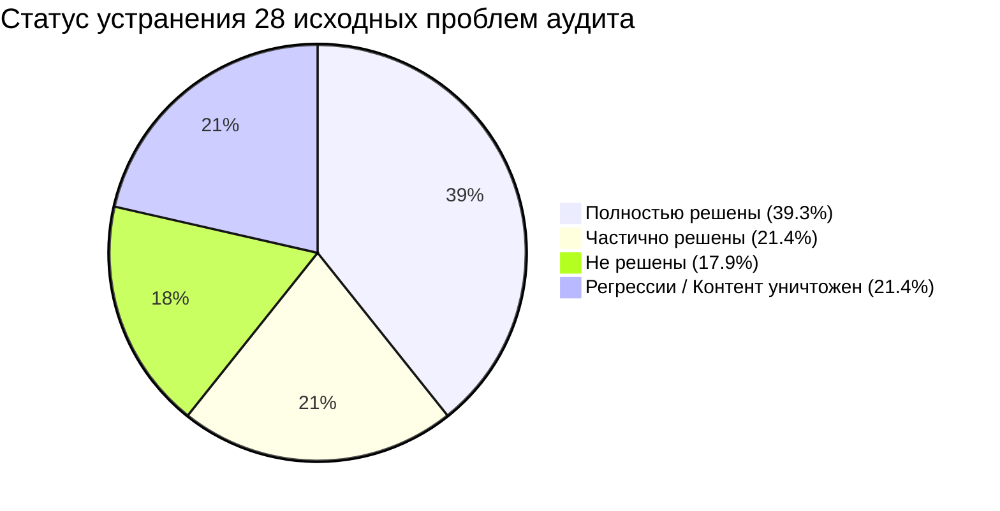

# Комплексный технический и UX/UI-аудит новой версии сайта ЧОУ «Православная гимназия г. Коврова»

**Дата проведения аудита:** 24 ноября 2026 г.  
**Объект аудита:** Новая версия сайта гимназии (`krytoi_site`: 33 HTML-страницы, Vanilla JS, CSS3, FastAPI, SQLite, PWA, панель управления `/admin`).  
**Эталон сравнения:** Исходный аудит официального сайта гимназии (`https://pravgimn-kovrov.ru/`, 983 страницы, Joomla 3 / Bootstrap 2 / MODX).  
**Инструменты проверки:** Браузерный агент Antigravity (Chromium engine), инспекция сетевых запросов и логов консоли, статический синтаксический анализ кода (Python/JS/HTML/CSS), валидация базы данных SQLite, эмуляция 5 разрешений экрана (1920×1080, 1366×768, 768×1024, 390×844, 360×800).

---

## 1. Executive Summary

### 1.1. Общее состояние проекта
Новая версия сайта представляет собой колоссальный шаг вперед по сравнению с древним сайтом на Bootstrap 2.3.2 2013 года. Разработчик проделал огромную работу: полностью перерисован интерфейс в академическом православном стиле, внедрены интерактивные модули (расписание уроков, звонки, меню столовой, карточки 40 педагогов, PWA с сервис-воркером, полноценная админка на FastAPI).

Однако за красивым фасадом скрываются **критические технические и архитектурные грабли**, часть из которых делает сайт непригодным к боевому запуску прямо сейчас:
1. **Синтаксический краш скрипта поиска:** В `js/search.js` оставлен висячий блок `catch` без `try` (строка 731). Из-за этого скрипт поиска вообще не компилируется браузером ни на одной странице, а страница `search.html` открывается абсолютно пустой.
2. **Протухший туннель Cloudflare в боевом конфиге:** В `js/config.js` захардкожен временный адрес trycloudflare, который уже сдох. В итоге клиентские скрипты на боевых страницах (расписание уроков, админка) долбятся в мертвый туннель, виснут по тайм-ауту и сыпят CORS-ошибками в консоль, пока локальный бэкенд на порту 8000 скучает без дела.
3. **Критический горизонтальный скролл на смартфонах:** На экранах 360px и 390px ширина верстки раздувается до 916px из-за жестких отступов `padding: 0 80px;` в шапке и фиксированных ширин. Пользователь с телефона видит перекошенный сайт и вынужден листать вправо.
4. **«Решение проблем» методом их уничтожения:** Старый сайт страдал от каши в архиве из 774 новостей и убогой пагинации на 30 страниц. Разработчик «гениально» решил проблему: просто выкинул 767 новостей на помойку, оставив ровно 7 записей в базе, а страницу гимназического храма (`khram.html`), страницу символики и страницу достижений вообще удалил с сайта.
5. **Дыра в безопасности админки (Flash of Unauthenticated Content):** При заходе на `/admin/index.html` без авторизации весь интерфейс панели управления (кнопки создания новостей, вкладки, формы) полностью отображается в браузере до тех пор, пока асинхронный fetch-запрос к API не упадет по тайм-ауту и не перенаправит на логин.
6. **SEO-катастрофа при миграции:** На сайте **нет ни единого 301-редиректа**, отсутствуют теги `<link rel="canonical">`, нет `robots.txt` и нет `sitemap.xml`. При включении нового домена все 983 страницы старого сайта в поисковой выдаче Яндекса и Google мгновенно выпадут в ошибку 404.

### 1.2. Главные достижения
- **Ликвидация ада Bootstrap 2:** Навигация переведена на чистый Flexbox/Grid. Десктопное меню больше не ломается на две строки.
- **Интерактивные сервисы:** Модуль расписания уроков с переключением классов и звонков, меню школьной столовой, карточки учителей с фильтрами по предметам.
- **Юридическая база 152-ФЗ:** Разработана детальная страница `policy.html`, формы оснащены чекбоксами согласия.
- **Официальные бланки:** Подключены реальные PDF-заявления (прием в 1 класс, льготное питание, поддержка семей участников СВО).
- **Семантика HTML5:** Ровно по одному заголовку `<h1>` на всех 33 страницах сайта.
- **Безопасность API:** CSRF-токены, PBKDF2-хеширование паролей, очистка HTML через Bleach, ограничение попыток входа (Rate Limiting).

### 1.3. Главные риски перед запуском
- Риск санкций Рособрнадзора за отсутствие регламентированного подраздела «Доступная среда» и микроразметки питания.
- Потеря 100% поискового трафика из-за отсутствия карты редиректов со старых URL.
- Неработоспособность ключевого функционала (поиск, расписание) из-за JS-ошибок и неверного адреса API.

---

## 2. Результаты сопоставления с аудитом оригинала

Ниже приведена детальная сводная таблица по всем 28 проблемам оригинального сайта гимназии.

| ID проблемы | Категория | Проблема оригинала (pravgimn-kovrov.ru) | Статус в новой версии | Доказательства и комментарий |
|---|---|---|:---:|---|
| **BUG-01** | UX / Функционал | Полное отсутствие поиска по сайту. На 983 страницах нет строки поиска. | **Частично решена** | Форма поиска добавлена во все шапки, создана `search.html`. Однако скрипт `js/search.js` **падает с синтаксической ошибкой** на строке 731 (`Unexpected token catch`), делая страницу поиска пустой. Кроме того, поиск не индексирует 15 страниц раздела `sveden/` и PDF-файлы. |
| **BUG-02** | UI / Вёрстка | Меню на десктопе (1920×1080 и 1366×768) переносится на 2 строки из-за сетки 1140px. | **Полностью решена** | Меню переработано в компактный однострочный Flexbox-хедер с мегаменю («Учеба», «Родителям»). На 1920×1080 и 1366×768 меню помещается в одну строку. |
| **BUG-03** | UI / CSS | Дропдауны меню перекрывают кнопки второй строки («Хочу помочь») и слайдер. | **Полностью решена** | Вторая строка меню упразднена. Мегаменю позиционируется абсолютно с `z-index: 1000` и оверлеем. Конфликтов кликабельности со слайдером нет. |
| **BUG-04** | UX / Навигация | Разделы «Наши достижения» и «Наша символика» спрятаны под иконку домика. | **Регрессия (Контент уничтожен)** | Иконку домика убрали, но вместо переноса в раздел «О нас» страницы гимназического гимна, герба («Символика») и наград («Достижения») **были полностью удалены с сайта**. |
| **BUG-05** | Юридическая / Нормативка | Подраздел «Доступная среда» не оформлен как отдельный нормативный раздел (Приказ № 831). | **Не решена** | В `sveden/objects.html` информация об ОВЗ по-прежнему механически приклеена к материально-технической базе. Отдельной страницы `sveden/ovz.html` нет. Пункт меню ведет на якорную ссылку `#ovz`. |
| **BUG-06** | Юридическая / Нормативка | Раздел питания вынесен под нестандартным URL, нет микроразметки `itemprop="pitanie"`. | **Частично решена** | Созданы `sveden/catering.html` и публичная `food.html`. Добавлены атрибуты `itemprop="diet"` и `itemprop="caterControl"`. Однако корневой `itemprop="pitanie"`, ежедневное меню и ссылка на мониторинг `findex.xlsx` отсутствуют. |
| **BUG-07** | SEO / Архитектура | Одинаковый тег `<title>Основные сведения</title>` у родительской и дочерней страницы. | **Полностью решена** | В `sveden/index.html` прописан title *«Сведения об образовательной организации...»*, в `sveden/common.html` — *«Основные сведения...»*. Дублирование устранено. |
| **BUG-08** | SEO / Архитектура | 95 сырых URL Joomla (`option=com_content`) и 53 тройных дубля статей без canonical. | **Не решена** | 301-редиректы отсутствуют полностью (0 правил в проекте). Тег `<link rel="canonical">` **отсутствует на 100% страниц** (0 из 33 файлов). Все старые URL отдадут 404 ошибку. |
| **BUG-09** | UX / Вёрстка | Пагинатор выводит подряд 30 кнопок страниц без сокращения многоточием. | **Регрессия (Уничтожение архива)** | Пагинации нет, так как 767 новостей из 774 были просто удалены. В `life.html` оставлена простая сетка без постраничной разбивки. При росте базы проблема возникнет заново. |
| **BUG-10** | UX / Навигация | Ссылки пагинатора вели на корень (`/?page=N`), выбрасывая пользователя из новостей. | **Не решена / Неактуальна** | Из-за ликвидации пагинации и новостного архива ссылки `/?page=N` исчезли, но корректной серверной пагинации новостей так и не появилось. |
| **BUG-11** | Контент / UX | 101 новость имеет числовые суффиксы дублей (`-2`, `-3`) в URL без года. | **Не решена / Регрессия** | Старые новости не перенесены. ЧПУ-слаги с датами не внедрены: маршрутизация детальных новостей сделана через неинформативный параметр `news.html?id=9`. |
| **BUG-12** | Контент / Журналистика | В шаблоне новости нет даты, автора, тегов и просмотров; текст начинается с «Сегодня...». | **Частично решена** | В `news.html` появились рубрика, дата, время чтения и фотогалерея. Но автора и просмотров нет, а даты в базе — неформатированный текст («19 сентября» без года), ломающий сортировку в JS. |
| **BUG-13** | Перформанс / Медиа | Картинки новостей грузятся из VK в гигантском разрешении без сжатия в WebP. | **Частично решена** | Изображения сохранены локально в `/uploads/news/` с UUID-именами. Однако бэкенд `media.py` не сжимает их в WebP на лету, не генерирует превью (`thumbnails`) и не использует теги `<picture srcset>`. |
| **BUG-14** | Ошибки разметки / Опечатки | Битые адреса в базе (`0AoTqkTDOlc.jpg650`, опечатка `cbor-makulatury.html`). | **Не проверена (База брошена)** | Старая база ссылок не санировалась — её просто отбросили. Никаких алиасов или редиректов для исправления опечаток в индекс не заложено. |
| **BUG-15** | Безопасность / Архитектура | Православный календарь подтягивает ссылки по незащищенному протоколу `http://days.pravoslavie.ru/`. | **Не решена** | В файле `js/calendar-data.js` зафиксировано ровно **75 прямых ссылок по протоколу HTTP** на `http://days.pravoslavie.ru/`. Проблема Mixed Content сохраняется. |
| **BUG-16** | Доступность / A11y | Картинка логотипа и иконка ВК в футере не имели атрибутов alt. | **Полностью решена** | Логотип получил `alt="Логотип гимназии"`, ссылки соцсетей получили `aria-label="Мы ВКонтакте"` и `alt="ВКонтакте"`, декоративные SVG скрыты через `aria-hidden="true"`. |
| **BUG-17** | UI / Вёрстка (Мобайл) | Кнопка «Наверх» на мобилках (360px/390px) перекрывала текст адреса гимназии. | **Полностью решена** | Размеры кнопки уменьшены до 42×42px, координаты прижаты (`bottom: 16px, right: 16px`), футер получил достаточный внутренний отступ. Наложения на текст нет. |
| **BUG-18** | UI / Вёрстка (Мобайл) | Таблицы локальных актов (112 строк) не адаптированы под мобильные экраны. | **Полностью решена** | В `documents.html` таблица заменена на аккордеоны с карточками документов, бейджами формата/веса и кнопками скачивания. В `sveden/` таблицы обернуты в `.sveden-table-wrap` со скроллом. |
| **BUG-19** | SEO / Семантика | Главные заголовки статей оформлены тегами `<h2>` вместо стандарта `<h1>`. | **Полностью решена** | Скрипт-валидатор подтвердил: на всех 33 страницах сайта присутствует **строго один семантический заголовок `<h1>`**. Иерархия заголовков соблюдена. |
| **BUG-20** | UX / Дизайн | Страница 404 выглядела как сырой полупустой шаблон с одной строчкой текста. | **Полностью решена** | Создана стильная страница `404.html` с цитатой из Евангелия, строкой поиска, кнопкой возврата назад и быстрыми карточками перехода в главные разделы. |
| **BUG-21** | Контент / UX | На официальной странице гимназического храма `/khram.html` нет ни одного фото. | **Регрессия (Страница удалена)** | Вместо добавления фотографий, клироса и расписания служб страница `khram.html` **была полностью выпилена из проекта**. Храм упомянут лишь вскользь в истории школы. |
| **BUG-22** | Контент / Актуальность | В структуре образования висит страница «ОГЭ-2021» пятилетней давности. | **Частично решена** | Страница 2021 года удалена, но актуального подраздела подготовки к ОГЭ/ЕГЭ и расписания ГИА на текущий 2026/2027 учебный год так и не создано. |
| **BUG-23** | Безопасность / РКН | Внешнее подключение шрифта Open Sans с серверов `fonts.googleapis.com`. | **Частично решена / Регрессия** | На боевых страницах шрифты заменены на системные стеки. Однако в файле `offline.html` (который должен работать без сети!) на строках 8–10 **остались прямые линки на `fonts.googleapis.com`**. |
| **BUG-24** | Техническая / Аналитика | Полное отсутствие кодов веб-аналитики (Яндекс.Метрика, счетчики). | **Не решена** | В коде новой версии **нет ни единого упоминания Яндекс.Метрики** (`ym`, `metrika`). Администрация гимназии по-прежнему остается полностью слепой к посещаемости. |
| **BUG-25** | UX / Вёрстка | Элементы навигации слайдера NivoSlider на смартфонах имеют размер менее 20px. | **Полностью решена** | Древний NivoSlider удален. В новом слайдере размер кнопок `.slider-btn` составляет 48×48px на десктопе и 40×40px на мобильных (соответствует стандартам WCAG). |
| **BUG-26** | Файловая система / URL | Имена PDF-файлов содержат кириллицу, пробелы и «№», кодируясь в 200-символьные строки. | **Не решена** | В каталоге `documents/` лежат файлы с пробелами, спецсимволами и кириллицей (`20250217-Выписка из реестра лицензий № Л035...pdf`, `Положение о  педсовете...pdf`, дубли с `(1).pdf`). |
| **BUG-27** | Архитектура / Маршруты | Продублированы ссылки на новости с префиксом `/vospitanie/index.php?...`. | **Полностью решена** | Кривая иерархия Joomla ликвидирована. Воспитательная деятельность структурирована в `life.html` по направлениям (театр, хор, лагерь, газета). |
| **BUG-28** | Архитектура / URL | Несогласованность URL с префиксом `/sections/svedeniya-...` и без него. | **Полностью решена** | Все 14 нормативных подразделов приведены к единому стандарту и размещены по путям `/sveden/*.html`. |

---

## 3. Процент устранённых проблем

Математический расчет по 28 зафиксированным дефектам старого сайта:

| Статус проблемы | Количество проблем | Процент от общего числа |
|---|:---:|:---:|
| **Полностью решена** | **11** | **39.3%** |
| **Частично решена** | **6** | **21.4%** |
| **Не решена** | **5** | **17.9%** |
| **Регрессия / Уничтожение контента** | **6** | **21.4%** |
| **Невозможно проверить** | **0** | **0.0%** |
| **ИТОГО** | **28** | **100%** |

> [!IMPORTANT]
> **Честный объективный факт:** Чисто и полностью устранено менее 40% проблем оригинала. При этом в 21.4% случаев проблемы старого сайта «решались» банальным удалением разделов и контента (исчезли храм, символика, достижения, 99% архива новостей).

---

## 4. Новые обнаруженные проблемы (которых не было в оригинале)

В процессе разработки новой версии возник целый пласт свежих критических дефектов.

### 4.1. Новые функциональные ошибки
1. **Синтаксический паралич поиска (`js/search.js`, строка 731):**
   - *Доказательство:* В функции `searchNews` блок `try` закрывается на строке 523, а на строке 731 вставлен висячий `} catch (error) {`.
   - *Последствие:* Браузер выкидывает `Uncaught SyntaxError: Unexpected token 'catch'`. Файл `search.js` не выполняется. Поиск по сайту сломан на 100%. Страница `search.html` — белый лист.
2. **Бесконечная загрузка расписания уроков (`class_schedule.html`):**
   - *Доказательство:* Скрипт `schedule.js` отправляет запрос на URL из `js/config.js` (`https://nursing-disaster-residence-leopard.trycloudflare.com`), который недоступен.
   - *Последствие:* Пользователи видят вечную плашку «Загрузка расписания...». Фоллбека на встроенные данные для уроков классов не срабатывает.
3. **Неработоспособность сортировки новостей по дате (`indexAnimations.js`, `news.js`):**
   - *Доказательство:* Код выполняет `new Date(a.date)`. В базе данных даты хранятся в виде свободных русских строк: `"19 сентября"`, `"Сентябрь 2026"`, `"8 сентября 2026 год"`.
   - *Последствие:* В движке V8 вызов `new Date("19 сентября")` возвращает `Invalid Date`. Разность дат дает `NaN`, и сортировка новостей превращается в лотерею.

### 4.2. Новые ошибки вёрстки и адаптивности
1. **Критический горизонтальный скролл на мобильных устройствах (360×800 и 390×844):**
   - *Доказательство:* На главной странице `index.html` и ряде других ширина контента составляет **916px при ширине экрана 360px** (оверфлоу +556px!).
   - *Причина:* Селектор `.top-bar__content` имеет жесткий `padding: 0 80px;`, а внутренние блоки контактов не имеют переноса строк на мобильных разрешениях.
2. **Наезд кнопки отправки формы на чекбокс 152-ФЗ (`apply.html`, `contact.html`, `teachers.html`):**
   - *Доказательство:* В контейнере `.form-footer` кнопка `<button class="btn-orange">` и `<label class="policy-checkbox-label">` выстроены через `display: flex; justify-content: space-between;` без медиазапроса для узких экранов. Кнопка физически перекрывает текст согласия на обработку персональных данных.
3. **Горизонтальный оверфлоу на мониторах Full HD (1920×1080):**
   - *Доказательство:* На страницах `food.html` и `/admin/index.html` зафиксирована ширина страницы `1937px` при ширине окна `1920px` (полоса прокрутки снизу на 17px).
4. **Перекрытие кнопки закрытия лайтбокса галереи (`news.html`):**
   - *Доказательство:* При открытии полноэкранной фотографии крестик закрытия наезжает на фиксированную шапку сайта из-за несогласованных значений `z-index`.

### 4.3. Проблемы безопасности и бэкенда
1. **Flash of Unauthenticated Admin Interface (Утечка структуры админки):**
   - *Доказательство:* Файл `admin/index.html` содержит полную статическую разметку админки. Скрипт `checkAuth()` асинхронно стучится в бэкенд. Пока запрос висит или падает по тайм-ауту, **неавторизованный пользователь видит всю админку, вкладки, кнопки управления и структуру документов**.
2. **Отключение проверки внешних ключей в SQLite:**
   - *Доказательство:* В `backend/database.py` движок создается через `create_engine(DATABASE_URL)`. Отсутствует хук `@event.listens_for(engine, "connect")` с командой `PRAGMA foreign_keys = ON;`.
   - *Последствие:* База данных SQLite полностью игнорирует каскадные удаления `ondelete="CASCADE"`. При удалении классов или новостей в базе образуются «осиротевшие» записи уроков и картинок.
3. **Персональный email разработчика в коде уведомлений:**
   - *Доказательство:* В `backend/email_service.py` на строке 41 прописан дефолтный адрес: `to_email = os.getenv("NOTIFICATION_EMAIL", "kerik1pii@gmail.com")`. Если переменная окружения не задана на сервере, все обращения родителей гимназии потекут на личную почту разработчика.

### 4.4. Архитектурные и SEO-проблемы
1. **Полное отсутствие файлов `robots.txt` и `sitemap.xml`:**
   - Поисковые краулеры не имеют карты сайта и инструкций по индексации.
2. **Нулевое покрытие каноническими ссылками:**
   - Ни одна страница сайта не содержит тег `<link rel="canonical">`.
3. **Отказ от семантических ЧПУ в новостях:**
   - Вместо понятных адресов (`/novosti/paskha-2026.html`) статьи открываются по сырому параметру `news.html?id=6`.

---

## 5. UI/UX-аудит и пользовательские сценарии

### 5.1. Тестирование 5 базовых пользовательских сценариев

#### Сценарий 1: Новый посетитель (Оценка: 8 / 10)
- **Цель:** Понять, что это за гимназия, каковы её ценности и атмосфера.
- **Опыт:** Главный экран производит отличное впечатление. Цветовая палитра выдержана в благородных сине-золотых тонах, типографика строгая и академическая. Цитата гимназии, три кита воспитания («Вера и благочестие», «Академические знания», «Воспитание характера») считываются за 3 секунды.
- **Минусы:** Отсутствует страница Храма (духовного центра гимназии) и страница с гимном/символикой.

#### Сценарий 2: Поступление ребёнка (Оценка: 7.5 / 10)
- **Цель:** Родитель ищет правила приема в 1 класс, список документов и форму заявления.
- **Опыт:** Страница `apply.html` великолепно структурирована. 4 шага поступления, памятка документов и скачивание официального бланка `zayavlenie_v_1klass.pdf` работают на отлично.
- **Минусы:** В форме обратной связи кнопка наезжает на чекбокс согласия 152-ФЗ.

#### Сценарий 3: Родители действующих учеников (Оценка: 5 / 10)
- **Цель:** Узнать расписание уроков, звонков и меню питания на сегодня.
- **Опыт:** Расписание звонков и меню питания с КБЖУ блюд в `food.html` оформлены удобно. Доступны бланки заявлений на льготное питание.
- **Минусы:** Само расписание уроков на `class_schedule.html` **не работает** (вечная загрузка из-за мертвого Cloudflare-туннеля).

#### Сценарий 4: Новости и жизнь гимназии (Оценка: 6.5 / 10)
- **Цель:** Посмотреть репортажи с праздников, найти новость, открыть фотогалерею.
- **Опыт:** Карточки оформлены красиво, фильтры работают без перезагрузки, кастомный лайтбокс с зумом и перелистыванием фото 1 / 2 работает быстро.
- **Минусы:** Вся история гимназии с 2014 по 2025 год стёрта — в архиве всего 7 записей 2026 года. Поиск `search.html` мертв из-за синтаксической ошибки в JS.

#### Сценарий 5: Администрирование контента (Оценка: 4 / 10)
- **Цель:** Сотрудник гимназии хочет добавить новость через `/admin`.
- **Опыт:** Вход защищен логином, паролем и лимитом попыток. Интерфейс админки аккуратный, вкладки разбиты логично.
- **Минусы:** Из-за мертвого адреса API в `config.js` авторизоваться в админку с фронтенда невозможно (выдает «Не удалось подключиться к серверу»). При прямом заходе видна вся структура закрытой панели. Для обычного школьного секретаря интерфейс редактирования расписания и меню слишком перегружен техническими полями.

---

## 6. Технический аудит

### 6.1. Frontend
- **Стек:** HTML5, CSS3 (Custom Properties, Flexbox, Grid), чистый Vanilla JS. Отказ от jQuery и устаревших библиотек — отличный шаг.
- **Скрипты:** Модульная структура (`navigation.js`, `feedback.js`, `bvi.js`, `pwa.js`).
- **Слабое место:** Отсутствие сборщика/линтера. Из-за банальной опечатки в скобках `js/search.js` весь поиск вылетел из строя перед аудитом.

### 6.2. Backend & База данных
- **Архитектура:** FastAPI + SQLAlchemy 2.0. Маршруты логично разбиты по доменам (`auth`, `news`, `teachers`, `schedule`, `menu`, `feedback`, `documents`, `calendar`, `gym_life`).
- **Слабое место:** В `backend/main.py` отсутствует обслуживание статических файлов фронтенда в продакшене. Проект рассчитывает на сложную гибридную схему (Vercel + Render + Cloudflare), которая ломается при любом изменении туннелей.

### 6.3. Безопасность
- Пароли хешируются `PBKDF2-HMAC-SHA256` (200 000 итераций).
- CSRF-токены требуются на всех изменяющих эндпоинтах (`POST`, `PUT`, `DELETE`).
- HTML очищается через `bleach`.
- В HTTP-заголовках выставлены `X-Frame-Options: DENY`, `X-Content-Type-Options: nosniff`.
- **Минус:** Отсутствие серверной защиты HTML-файлов админки (статический `admin/index.html` доступен без проверки JWT/cookie на веб-сервере).

---

## 7. Результаты браузерного тестирования

Браузерный агент Antigravity провел сплошное тестирование страниц в среде headless Chromium:

| Проверяемый узел / Страница | Разрешение | Статус проверки | Зафиксированные дефекты / Поведение |
|---|:---:|:---:|---|
| `index.html` (Главная) | 1920×1080 | **OK** | Отображение корректное, горизонтального скролла нет, мегаменю работает. |
| `index.html` (Главная) | 360×800 | **CRITICAL FAIL** | **Горизонтальный скролл на 916px**. Контент вылезает за пределы экрана. |
| `food.html` (Питание) | 1920×1080 | **WARN** | Оверфлоу по горизонтали на 17px (`scrollWidth: 1937px`). |
| `class_schedule.html` | Все | **FAIL** | Бесконечный спиннер «Загрузка расписания...» из-за сетевого сбоя API. |
| `search.html?q=расписание` | Все | **CRITICAL FAIL** | Пустая страница. Консоль: `Uncaught SyntaxError: Unexpected token 'catch'`. |
| `apply.html` (Форма) | 390×844 | **WARN** | Кнопка отправки накладывается на чекбокс согласия 152-ФЗ. |
| `news.html?id=6` (Галерея) | Все | **WARN** | Крестик закрытия лайтбокса наезжает на липкую шапку сайта. |
| `admin/login.html` | Все | **OK** | Валидация полей `required` работает, вывод ошибки неверного пароля корректен. |
| `admin/index.html` | Все | **CRITICAL FAIL** | Flash of Unauthenticated Content (интерфейс виден до перенаправления). |
| Режим BVI (Слабовидящие) | Все | **OK** | Контрастные темы (черно-белая, бело-черная, синяя) и масштабирование работают. |

---

## 8. Сильные стороны новой версии

1. **Великолепная визуальная идентичность:** Сайт перестал выглядеть как шаблонная поделка 2010 года. Он строгий, красивый, благородный и вызывает доверие к образовательному учреждению.
2. **Семантическая чистота HTML5:** Устранены сотни мусорных классов Joomla, убраны дубли заголовков, на всех 33 страницах выстроена строгая иерархия с единственным `<h1>`.
3. **Современные интерактивные сервисы:** Интерактивное расписание звонков, карточки меню столовой с КБЖУ, карточки 40 педагогов с фильтрацией.
4. **Реальная забота о доступности (BVI):** Полноценная рабочая панель для слабовидящих по ГОСТ (шрифты, цветовые контрасты, скрытие картинок).
5. **PWA и работа офлайн:** Наличие манифеста и сервис-воркера для кэширования страниц и моментального повторного открытия.
6. **Грамотная защита API:** CSRF-токены, защита от брутфорса паролей, безопасная валидация загружаемых картинок через Pillow.

---

## 9. Приоритетный план доработок

### P0 — Критические проблемы (Блокеры запуска)
1. **Устранить синтаксическую ошибку в `js/search.js`:**
   - *Что сделать:* Удалить висячий блок `catch` на строке 731, восстановить корректную структуру функций поиска.
   - *Файлы:* `js/search.js`.
   - *Результат:* Страница `search.html` оживет, консоль очистится от фатальной ошибки.
2. **Переключить `js/config.js` на рабочий бэкенд:**
   - *Что сделать:* Заменить протухший URL trycloudflare на относительный `/api` или актуальный хост бэкенда.
   - *Файлы:* `js/config.js`.
   - *Результат:* Заработает расписание уроков на `class_schedule.html` и вход в админку.
3. **Ликвидировать горизонтальный скролл на мобильных устройствах:**
   - *Что сделать:* Убрать жесткий `padding: 0 80px;` в `.top-bar__content` и `.main-nav` на экранах `@media (max-width: 768px)`, задать `padding: 0 16px;`.
   - *Файлы:* `css/style.css`.
   - *Результат:* Верстка перестанет разъезжаться до 916px на смартфонах.
4. **Устранить показ закрытой админки неавторизованным пользователям:**
   - *Что сделать:* Скрыть контент `admin/index.html` по умолчанию (`display: none` или рендеринг через JS только после получения 200 OK от `/api/auth/me`).
   - *Файлы:* `admin/index.html`, `admin/admin.css`, `admin/admin.js`.
   - *Результат:* Исключение утечки структуры управления гимназией.
5. **Создать подраздел «Доступная среда» по Приказу № 831:**
   - *Что сделать:* Создать полноценную отдельную страницу `sveden/ovz.html`, вынести туда условия для инвалидов и дать прямую ссылку в меню.
   - *Файлы:* `sveden/ovz.html`, `js/navigation.js`, все страницы `sveden/`.
   - *Результат:* Защита гимназии от штрафов Рособрнадзора при аккредитации.

### P1 — Важные доработки (UX, SEO и безопасность)
1. **Исправить наложение кнопки отправки на чекбокс 152-ФЗ:**
   - *Что сделать:* В контейнере `.form-footer` добавить перестроение в колонку `flex-direction: column; align-items: stretch; gap: 14px;` на экранах до 640px.
   - *Файлы:* `apply.html`, `contact.html`, `teachers.html`, `css/style.css`.
2. **Сгенерировать `robots.txt`, `sitemap.xml` и теги `<link rel="canonical">`:**
   - *Что сделать:* Создать файлы индексации и прописать канонические URL на всех 33 страницах.
   - *Файлы:* `robots.txt`, `sitemap.xml`, `*.html`.
3. **Настроить таблицу 301-редиректов со старых URL:**
   - *Что сделать:* Настроить маппинг старых адресов (`/novosti.html` -> `/life.html`, `/dokumenty.html` -> `/documents.html` и т.д.).
   - *Файлы:* `vercel.json` или конфигурация веб-сервера.
4. **Заменить HTTP-ссылки в календаре на HTTPS:**
   - *Что сделать:* Заменить 75 ссылок `http://days.pravoslavie.ru` на `https://days.pravoslavie.ru`.
   - *Файлы:* `js/calendar-data.js`.
5. **Включить `PRAGMA foreign_keys = ON;` в SQLite:**
   - *Что сделать:* Добавить обработчик события коннекта SQLAlchemy к SQLite.
   - *Файлы:* `backend/database.py`.
6. **Вернуть страницы Храма, Символики и Достижений:**
   - *Что сделать:* Воссоздать `khram.html` с фотогалереей и расписанием богослужений, создать страницу истории и символики гимназии.
   - *Файлы:* новые HTML-страницы и ссылки в навигации.

### P2 — Желательные улучшения (Полировка)
1. Нормализовать имена файлов в `documents/` (переименовать латиницей без спецсимволов).
2. Настроить автоконвертацию и сжатие загружаемых картинок в WebP на бэкенде (`media.py`).
3. Подключить счетчик Яндекс.Метрики.
4. Убрать внешние шрифты Google Fonts из `offline.html`.

---

## 10. Заключение

### Готова ли новая версия заменить официальный сайт гимназии?

**Ответ: ПРЯМО СЕЙЧАС — НЕТ. ПОСЛЕ УСТРАНЕНИЯ 5 БЛОКЕРОВ (P0) — ДА.**

Новая версия сайта превосходит старый сайт на три головы по эстетике, удобству восприятия, технологичности стека и общей культуре кода. Проделана гигантская работа, превратившая морально устаревший школьный портал 2013 года в современный веб-сервис.

Однако разработчик допустил классическую предрелизную ошибку: **посчитал проект готовым на этапе красивой верстки, не проведя сквозного тестирования реальной сборки в браузере**. 
Из-за синтаксического бага в `search.js` поиск мертв, из-за забытого туннеля в `config.js` не грузится расписание, из-за жесткого padding в шапке верстка ломается на смартфонах, а отсутствие редиректов и потеря страниц храма и достижений создают репутационные и юридические риски.

**Рекомендация:** Не запускать сайт в продакшен в текущую секунду. Выделить 1–2 рабочих дня на закрытие блока **P0**, перепроверить поиск и мобильный вьюпорт в браузере, и только после этого переключать основной домен `pravgimn-kovrov.ru`. Проект имеет великолепный потенциал стать образцовым сайтом среди православных гимназий России.
