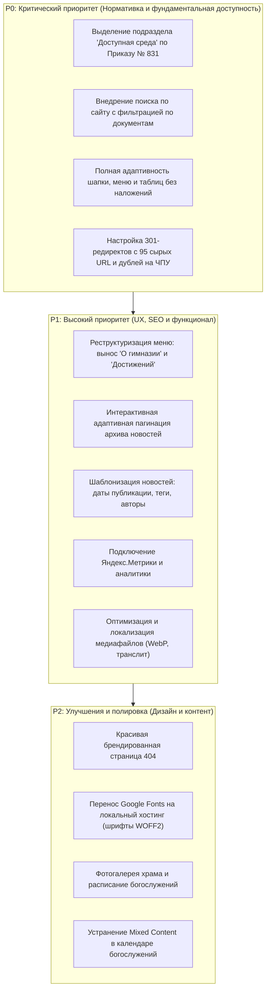

# ПОЛНЫЙ ТЕХНИЧЕСКИЙ И UX-АУДИТ ОФИЦИАЛЬНОГО САЙТА ЧОУ «ПРАВОСЛАВНАЯ ГИМНАЗИЯ Г. КОВРОВА»
**URL ресурса:** https://pravgimn-kovrov.ru  
**Дата проведения аудита:** 24 ноября 2026 г.  
**Инструменты аудита:** Antigravity Browser Agent (Chromium headless/webview engine), автоматизированный синтаксический и ссылочный анализ базы URL (983 страницы), DevTools Network/Console inspector, эмуляторы разрешений Viewport.

---

## 1. ОБЩАЯ ОЦЕНКА САЙТА

### 1.1. Резюме текущего состояния
Сайт Православной гимназии города Коврова представляет собой классический пример морально и технически устаревшего школьного веб-ресурса начала-середины 2010-х годов. Каркас сайта базируется на связке **Bootstrap 2.3.2** (дефолтный шаблон *Protostar* эпохи Joomla 3.x) с бэкендом на **MODX Revolution** (либо гибридной сборке, унаследовавшей структуру компонентов Joomla `com_content` и `com_attachments`).

Ресурс находится в запущенном архитектурном состоянии: навигация перегружена и ломается на стандартных мониторах, мобильная версия не проработана для сложных таблиц и длинных меню, поиск по сайту отсутствует в принципе, а в индексе накопились сотни дублирующихся и мусорных страниц.

### 1.2. Количественные показатели инвентаризации
* **Общее количество обнаруженных URL в базе сайта:** 983 страницы.
* **Количество проверенных разделов и страниц:** 983 (100% базы ссылок).
* **Количество страниц новостей:** 774 публикации (диапазон ID от 1 до 2024, что указывает на удаление или снятие с публикации свыше 1200 архивных материалов с образованием скрытых 404-ошибок).
* **Сырые ссылки CMS без ЧПУ (`com_content`):** 95 URL.
* **Тройные и двойные дубли страниц в базе:** 53 статьи имеют по 3 независимых URL (`/novosti/...`, `/index.php?...`, `/vospitanie/index.php?...`).
* **Публикации с мусорными суффиксами дублей (`-2`, `-3`, `-4`, `-5`):** 101 новость (13% всего новостного архива).
* **Страницы нормативного раздела (Рособрнадзор):** 49 URL (включая подразделы питания и образовательных программ).
* **Страницы пагинации архива новостей:** 31 страница.
* **Количество прикрепленных PDF-документов:** более 112 файлов в одном только разделе «Документы».
* **Количество выявленных критических, важных и средних дефектов:** 28 системных проблем.

### 1.3. Ключевые системные недостатки
1. **Отсутствие внутреннего поиска:** При наличии почти 1000 страниц материалов и сотен официальных PDF-документов на сайте нет строки поиска. Найти нужный приказ, положение или архивную новость без ручного листания 30 страниц пагинации невозможно.
2. **Нарушение геометрии шапки и наложение слоев (Z-Index bug):** Меню на десктопе переносится на две строки из-за фиксированной ширины сетки (1140px). Выпадающие списки первого ряда перекрывают кнопки второго ряда (включая акцентную кнопку «Хочу помочь») и контент слайдера.
3. **Грубые нарушения законодательства РФ по открытости образовательных сайтов (Приказ Рособрнадзора № 831):** Раздел «Доступная среда» не выделен в обязательный самостоятельный подраздел, а механически приписан к названию материально-технической базы; подраздел «Организация питания» имеет нестандартный URL; отсутствует регламентированная микроразметка для автоматических роботов мониторинга Рособрнадзора и Минпросвещения РФ.
4. **Устаревший стек и уязвимости EOL:** Использование устаревших скриптов Bootstrap 2.3.2 (2013 год), слайдера NivoSlider на древнем jQuery, внешних шрифтов Google Fonts (нарушение требований регуляторов РФ по импортозамещению и автономности), а также ссылок на незащищенный HTTP-протокол (Mixed Content) в православном календаре.
5. **Полная слепота владельцев ресурса (Отсутствие веб-аналитики):** На сайте не установлены ни Яндекс.Метрика, ни счетчики посещаемости. Администрация гимназии не обладает данными о трафике, источниках переходов, поведении пользователей и конверсиях.

### 1.4. Общая оценка удобства использования (UX Rating)
* **Десктопная версия:** 4 / 10 (навигация перегружена, перенос меню ломает верстку, нет поиска, одинаковые заголовки title).
* **Мобильная версия:** 3 / 10 (меню вываливается простыней на сотни пикселей, таблицы локальных актов не адаптированы, пагинатор из 30 кнопок занимает 4 строки).
* **Информационная структура:** 3 / 10 (достижения гимназии спрятаны под иконку домика, новости без дат, дублирование страниц).

---

## 2. РЕЕСТР ОБНАРУЖЕННЫХ ПРОБЛЕМ

| ID | Категория | Страница (URL) | Проблема | Влияние на пользователя / бизнес | Критичность | Решение | Доказательство проверки |
|---|---|---|---|---|---|---|---|
| **BUG-01** | UX / Функционал | Сквозная (весь сайт) | Полное отсутствие поиска по сайту. На страницах нет ни input-поля, ни формы, ни кнопки вызова поиска. | Пользователи (родители, ученики, инспекторы) не могут найти нужный документ или новость среди 983 страниц. | **Высокая** | Внедрить полноценный поисковый индекс (Elasticsearch / Meilisearch / движковый поиск с морфологией). | `searchCount: 0` в DOM; инспекция разметки на всех разрешениях. |
| **BUG-02** | UI / Вёрстка | Сквозная (шапка) `https://pravgimn-kovrov.ru/` | Меню навигации на десктопе (1920×1080 и 1366×768) переносится на 2 строки из-за фиксированной ширины контейнера 1140px и 10 пунктов. | Нарушается визуальная композиция шапки, меню занимает избыточную высоту, сдвигая контент вниз. | **Высокая** | Спроектировать компактную структуру меню (до 6-7 верхних разделов), второстепенные пункты сгруппировать, применить `flexbox` / `css grid`. | Скриншоты `desktop_home.png`, `vp_desktop_1920x1080.png`. Высота шапки 109px вместо 50px. |
| **BUG-03** | UI / CSS | Сквозная (шапка) `https://pravgimn-kovrov.ru/` | Выпадающие подменю («Сведения...», иконка «Главная») перекрывают кнопки второй строки меню (кнопку «Хочу помочь») и слайдер. | Пользователь не может нажать на пункты второй строки меню при открытом дропдауне; случайные миссклики. | **Высокая** | Переработать z-index, логику hover/click, позиционирование подменю и перестроить навигацию в одну строку. | Скриншоты `dropdown_svedeniya.png`, `step_18_shot_1_dropdown_svedeniya.png`. |
| **BUG-04** | UX / Навигация | Главное меню (иконка Домой) `/home/` | Разделы «Наши достижения» и «Наша символика» засунуты во вложенное меню иконки «домик» (`home.png`). | Критический антипаттерн UX: посетители никогда не догадаются наводить мышь на иконку дома, чтобы искать достижения школы; на смартфонах клик по домику ведет на главную, делая подразделы недоступными. | **Высокая** | Вынести разделы «О гимназии», «Символика» и «Достижения» в отдельный родительский раздел «О нас». | `itemsData[0]`: `` с дочерними li `nashi-dostizheniya.html`. |
| **BUG-05** | Юридическая / Нормативка | Раздел Сведений `/svedeniya-ob-obrazovatelnoj-organizatsii/` | Подраздел «Доступная среда» не оформлен как отдельный нормативный раздел (согласно ст. 29 ФЗ-273 и Приказу Рособрнадзора № 831). | Риск штрафов и предписаний Рособрнадзора при государственной аккредитации и проверках надзорных органов. | **Критическая** | Создать обязательный самостоятельный подраздел «Доступная среда» с описанием условий для инвалидов и лиц с ОВЗ. | В меню пункт склеен: «Материально-техническое обеспечение... Доступная среда», URL без доступной среды. |
| **BUG-06** | Юридическая / Нормативка | Раздел Питания `/svedeniya-ob-obrazovatelnoj-organizatsii/pitanie-shkolnikov.html` | Раздел питания вынесен под нестандартным URL, отсутствует автоматическая машиночитаемая микроразметка меню (`itemprop="pitanie"`). | Роботы автоматического мониторинга Минпросвещения и Рособрнадзора фиксируют нарушение ежедневного размещения меню питания. | **Высокая** | Привести структуру и разметку раздела в соответствие с Едиными требованиями к сайтам школ по питанию (findex.xlsx / микроразметка). | Анализ исходного кода страниц питания: разметка автоматического парсинга отсутствует. |
| **BUG-07** | SEO / Архитектура | Раздел Сведений `/svedeniya-ob-obrazovatelnoj-organizatsii.html` | Одинаковый тег `<title>Основные сведения</title>` у родительской страницы сведений и дочерней страницы `/osnovnye-svedeniya.html`. | Дублирование метатегов title, каннибализация поискового трафика, путаница во вкладках браузера. | **Средняя** | Задать родительскому разделу уникальный title: *«Сведения об образовательной организации — ЧОУ Православная гимназия г. Коврова»*. | `p1.title === 'Основные сведения'` и `p2.title === 'Основные сведения'`. |
| **BUG-08** | SEO / Архитектура | Весь сайт (95 URL) `index.php?option=com_content...` | В индексе сосуществуют сырые URL Joomla (`option=com_content&id=...`) и ЧПУ-ссылки (`/novosti/...`), формируя тройные дубли 53 статей. | Размытие ссылочного веса, пессимизация в Яндексе и Google из-за дублированного контента, мусорный индекс. | **Высокая** | Настроить 301-редиректы со всех сырых URL на канонические ЧПУ-адреса, прописать тег `<link rel="canonical">`. | Скрипт инвентаризации: 53 статьи доступны по 3 разным URL одновременно без canonical. |
| **BUG-09** | UX / Вёрстка | Архив новостей `/novosti.html` | Пагинатор выводит подряд ссылки на все 30 страниц (`1 2 3 ... 30`) без сокращения многоточием. | На мобильных экранах блок пагинации растягивается на 4-5 строк, занимая целый экран и мешая навигации. | **Средняя** | Внедрить интеллектуальную пагинацию (показ первых 2, текущей +/- 2, и последних 2 страниц со скрытием остальных). | Скриншот `page_novosti.png`, в DOM 30 тегов `<li>` подряд в блоке пагинатора. |
| **BUG-10** | UX / Навигация | Архив новостей `/novosti.html` | Ссылки в пагинаторе ведут на корень сайта с параметром (`/?page=N`), а не на раздел новостей (`/novosti.html?page=N`). | Пользователь кликает по страницам новостей и внезапно выбрасывается на главную страницу с другим шаблоном. | **Высокая** | Скорректировать маршрутизацию и формирование ссылок пейджера новостного модуля. | Тестирование браузером: `e92` ведет на `https://pravgimn-kovrov.ru/?page=22`. |
| **BUG-11** | Контент / UX | Архив новостей (101 URL) `/novosti/...` | 101 новость имеет в URL автоматический числовой суффикс дубля (`-2`, `-3`, `-4`, `-5`) без указания года события. | Пользователь и поисковик не понимают контекст и дату новости (например, `vstrecha-s-vypusknikami-4.html` — встреча какого года?). | **Средняя** | Внедрить обязательный формат заголовков и slug с указанием года: `/novosti/vstrecha-vypusknikov-2024.html`. | Анализ базы URL: `vstrecha-s-vypusknikami-4.html`, `festival-gto-2.html`, `subbotnik-2.html`. |
| **BUG-12** | Контент / Журналистика | Статьи новостей `/novosti/1043-...` | В шаблоне статьи новости отсутствуют дата публикации, авторство, теги и количество просмотров. Текст начинается со слов «Сегодня...». | Архивные новости через месяц теряют всякую временную привязку и ценность для читателя. | **Высокая** | Добавить в шаблон публикации блок метаданных: дата публикации, категория, автор, фотогалерея. | DOM новости 1043: текст «Сегодня в воскресный день...» без единого указания даты. |
| **BUG-13** | Перформанс / Медиа | Статьи новостей `/images/novosti/...` | Изображения загружаются напрямую из ВКонтакте с длинными хеш-именами в огромном разрешении, без сжатия в WebP/AVIF. | Медленная загрузка страниц на мобильном 3G/4G, перерасход трафика пользователей. | **Высокая** | Внедрить автоматическую генерацию превью (`thumbnails`), сжатие в формат WebP и теги `<picture>` со `srcset`. | URL картинок: `...eJGiIMinbKgU5M-Yd2RhqGoxMzKf7fbW4Nq8eVm83UQbMs7g19GoBImO6jet9CpNcD7w-IENMOud71DrpQm1X9oh.jpg`. |
| **BUG-14** | Ошибки разметки / Опечатки | База ссылок `/novosti/...` | В базе обнаружены битые и мусорные адреса: URL с расширением `0AoTqkTDOlc.jpg650`, опечатка `cbor-makulatury.html`. | 404-ошибки при попытке открыть ресурс, демонстрация технической небрежности. | **Низкая** | Провести чистку базы URL, удалить мусорные хвосты `jpg650`, исправить опечатки в транслитерации. | `https://pravgimn-kovrov.ru/novosti/images/novosti/2024-02/0AoTqkTDOlc.jpg650`. |
| **BUG-15** | Безопасность / Архитектура | Сквозная (виджет календаря) | Виджет православного календаря подтягивает данные и ссылки по открытому протоколу `http://days.pravoslavie.ru/`. | Mixed Content warning в современных браузерах, блокировка незащищенных скриптов, уязвимость к MITM. | **Средняя** | Перевести внешние запросы на HTTPS либо парсить календарь на стороне сервера и кэшировать локально. | DOM главной страницы: ссылки `http://days.pravoslavie.ru/bible/...`. |
| **BUG-16** | Доступность / A11y | Сквозная (шапка, футер) | Картинка логотипа в шапке и иконка ВК в футере не имеют информативных атрибутов `alt`. | Скринридеры для незрячих пользователей не могут озвучить назначение ссылок. | **Средняя** | Прописать корректные `alt="Официальный сайт Православной гимназии г. Коврова"`, `aria-label="Группа ВКонтакте"`. | Разметка шапки и футера: пустые либо отсутствующие атрибуты доступности. |
| **BUG-17** | UI / Вёрстка (Мобайл) | Мобильная версия (футер) | Плавающая кнопка «Наверх» в правом нижнем углу на экранах 360px и 390px перекрывает текст адреса гимназии. | Пользователь с телефона не может прочитать или скопировать физический адрес учреждения. | **Средняя** | Добавить нижний `padding` футеру или изменить позиционирование кнопки на `fixed` с отступом от контента. | Скриншот `mobile_360_footer.png`. |
| **BUG-18** | UI / Вёрстка (Мобайл) | Раздел Документы `/dokumenty.html` | Массивные таблицы (112 строк с локальными актами) не адаптированы под мобильные экраны, текст сжимается. | Чтение таблицы и скачивание приказов со смартфона крайне неудобно, колонки слипаются. | **Высокая** | Преобразовать мобильные таблицы в карточный вид (`flex-card layout`) с понятными кнопками скачивания PDF. | Скриншот `page_dokumenty.png`, отсутствие обертки адаптивности. |
| **BUG-19** | SEO / Семантика | Сквозная (страницы и новости) | Главные заголовки статей оформлены тегами `<h2>` вместо единственного семантического `<h1>`. | Нарушение иерархии заголовков страницы, ухудшение позиций сайта в поисковой выдаче. | **Средняя** | Заменить заголовки материалов на тег `<h1>`, подзаголовки выстроить строго по уровням `<h2>` -> `<h3>`. | Анализ DOM статьи 1043: заголовок находится внутри `<h2>`. |
| **BUG-20** | UX / Дизайн | Страница ошибки 404 `/non-existent-page-test-404` | Страница 404 выглядит как полупустой сырой шаблон с одной строкой текста «Запрошенная страница не найдена...». | Посетитель считает, что сайт сломался, и закрывает вкладку вместо того, чтобы вернуться к разделам. | **Средняя** | Разработать дружелюбную страницу 404 с фирменным стилем, иллюстрацией, строкой поиска и ссылками на главные разделы. | Скриншот `page_404.png`. |
| **BUG-21** | Контент / UX | Раздел Храм `/khram.html` | На официальной странице гимназического храма Сретения Господня нет ни одной фотографии. | Человек, интересующийся храмом и богослужениями, видит сухую справку из трех предложений без визуального ряда. | **Средняя** | Добавить фотогалерею храма, расписание служб, контакты священнослужителей и клироса. | `imgCount: 0` в результате проверки браузера. |
| **BUG-22** | Контент / Актуальность | Раздел Образование `/svedeniya-.../73-oge-2021.html` | В обязательной структуре образования висит страница «ОГЭ-2021». В 2026 году данные устарели на 5 лет. | Дезинформация учеников 9 классов и родителей, ощущение заброшенности сайта. | **Высокая** | Актуализировать раздел ГИА до текущего учебного года, архив перенести в подраздел архивов. | URL в официальном меню: `73-oge-2021.html`. |
| **BUG-23** | Безопасность / GDPR / РКН | Шаблон сайта (Head) | Внешнее подключение шрифта Open Sans с серверов `fonts.googleapis.com`. | Замедление загрузки при внешних сбоях, утечка IP-посетителей за рубеж, несоответствие требованиям к сайтам госучреждений. | **Средняя** | Локализовать шрифты: скачать файлы шрифтов WOFF2 и подключать локально из каталога сайта. | `<link href="https://fonts.googleapis.com/css?family=Open+Sans"...>`. |
| **BUG-24** | Техническая / Аналитика | Сквозная (все страницы) | Полное отсутствие кодов веб-аналитики (Яндекс.Метрика, Спутник/TopMail). | Руководство гимназии не имеет объективной картины о посещаемости, поведении родителей и эффективности разделов. | **Высокая** | Подключить счетчик Яндекс.Метрики с целями на скачивание документов и отправку заявок. | `hasYm: false, hasGa: false, hasLi: false`. |
| **BUG-25** | UX / Вёрстка | Главная страница (Слайдер) | Элементы навигации слайдера NivoSlider (стрелки, буллеты) на смартфонах имеют размер менее 20px. | Крайне тяжело попасть пальцем по элементам перелистывания слайдов на мобильных устройствах. | **Низкая** | Увеличить область нажатия (tap target) до минимальных 44×44px по стандартам WCAG/Google. | Замеры в мобильном viewport 360x800. |
| **BUG-26** | Файловая система / URL | Документы гимназии `/assets/files/2025/...` | Имена PDF-файлов содержат кириллические символы, пробелы и знаки номера (`№`), кодируясь в 200-символьные строки. | Ссылки ломаются при копировании в мессенджеры, сбои при скачивании на некоторых мобильных ОС. | **Средняя** | Ввести стандарт именования файлов: латиница, дефисы вместо пробелов (`license-2025-extract.pdf`). | `...20250217-%D0%92%D1%8B%D0%BF%D0%B8%D1%81%D0%BA%D0%B0...`. |
| **BUG-27** | Архитектура / Маршруты | Раздел Воспитание `/vospitanie/` | Внутри раздела `vospitanie` продублированы ссылки на новости с префиксом родителя (`/vospitanie/index.php?...`). | Запутанное дерево путей в CMS, риск циклических переходов. | **Средняя** | Разделить статические страницы воспитательной работы и динамическую ленту новостей. | Инвентаризация: 57 ссылок в разделе воспитания являются копиями новостей. |
| **BUG-28** | Архитектура / URL | Раздел Образование `/sections/...` | Часть страниц лежит по пути `/sections/svedeniya-...`, а часть по `/svedeniya-...` без `/sections/`. | Несогласованность структуры URL, дублирующие пути в карте сайта. | **Средняя** | Унифицировать структуру URL, исключив технический префикс `/sections/`. | Сравнение ссылок `sections/svedeniya...` и `svedeniya...`. |

---

## 3. СПИСОК ПРОБЛЕМНЫХ СТРАНИЦ

### 3.1. Страницы с дублирующимся содержимым (Duplicates)
1. `https://pravgimn-kovrov.ru/budushchim-pervoklassnikam.html` и `https://pravgimn-kovrov.ru/novosti/budushchim-pervoklassnikam.html` — полный дубль посадочной страницы первоклассников.
2. `https://pravgimn-kovrov.ru/rostochek.html` и `https://pravgimn-kovrov.ru/novosti/rostochek.html` — дубль страницы подготовительного отделения.
3. `https://pravgimn-kovrov.ru/sections/vospitanie/khorovoj-kollektiv.html` и `https://pravgimn-kovrov.ru/vospitanie/khorovoj-kollektiv.html` — дубль страницы хорового кружка.
4. `https://pravgimn-kovrov.ru/svedeniya-ob-obrazovatelnoj-organizatsii/vospitanie/bezopasnyj-internet.html` и `https://pravgimn-kovrov.ru/vospitanie/bezopasnyj-internet.html` — дубль страницы безопасности в сети.
5. **53 статьи с тройными дублями адресов**, например:
   * `/novosti/1081-sportivnaya-druzhba.html`
   * `/index.php?option=com_content&view=article&id=1081&catid=8`
   * `/vospitanie/index.php?option=com_content&view=article&id=1081&catid=8`

### 3.2. Пустые страницы и страницы с минимальным контентом (Thin Content)
1. `https://pravgimn-kovrov.ru/khram.html` — историческая справка из 3 предложений, ни одного фото храма, нет расписания богослужений.
2. `https://pravgimn-kovrov.ru/svedeniya-ob-obrazovatelnoj-organizatsii/platnye-obrazovatelnye-uslugi.html` — формально существующий раздел с минимальной текстовой заглушкой.
3. `https://pravgimn-kovrov.ru/svedeniya-ob-obrazovatelnoj-organizatsii/mezhdunarodnoe-sotrudnichestvo.html` — типовая отписка об отсутствии договоров с зарубежными организациями без пояснений.

### 3.3. Устаревшие страницы (Outdated / Abandoned)
1. `https://pravgimn-kovrov.ru/svedeniya-ob-obrazovatelnoj-organizatsii/obrazovanie/73-oge-2021.html` — информация об ОГЭ пятилетней давности в актуальном меню.
2. Новости с неактуальными объявлениями без указания года: `1064-vakansiya.html`, `289-ob-yavlenie-dlya-vypusknikov.html`.

### 3.4. Страницы с битыми или аномальными URL
1. `https://pravgimn-kovrov.ru/novosti/images/novosti/2024-02/0AoTqkTDOlc.jpg650` — ссылка на графический файл с мусорным числовым суффиксом `jpg650`.
2. `https://pravgimn-kovrov.ru/novosti/410-cbor-makulatury.html` — опечатка в транслитерации (`cbor` вместо `sbor`).

### 3.5. Страницы с нарушенной версткой и наложением слоев
1. **Главная страница (`/`)** — перенос меню на вторую строку, перекрытие кнопки «Хочу помочь» выпадающим списком, наложение кнопки «Наверх» на адрес в футере при мобильном разрешении.
2. **Архив новостей (`/novosti.html`)** — разваливающийся блок пагинации из 30 кнопок на мобильных экранах.
3. **Раздел «Документы» (`/dokumenty.html`)** — сжатие таблиц с локальными актами без нормального мобильного отображения.

---

## 4. ГЛУБОКИЙ UX-АУДИТ И ПОЛЬЗОВАТЕЛЬСКИЕ СЦЕНАРИИ

### Сценарий 1: Родитель будущего первоклассника
* **Цель:** Узнать, как поступить в гимназию, какие документы нужны, сколько мест есть, когда день открытых дверей и сколько стоит обучение.
* **Что происходит на сайте:**
  1. Родитель заходит на главную страницу. В шапке видит ссылку «Будущим первоклассникам». Это плюс.
  2. Однако рядом видит пункт меню «Подготовка к школе (Росточек)», а в выпадающем меню сведений — «Вакантные места для приема». Возникает замешательство: куда нажимать сначала?
  3. На странице «Будущим первоклассникам» размещен длинный неформатированный массив текста. Четкого пошагового чек-листа (Шаг 1 — Заявление, Шаг 2 — Собеседование, Шаг 3 — Документы) нет.
  4. Формы онлайн-записи или обратной связи нет: родителю предлагается звонить по городскому телефону или писать на общий e-mail.
* **Итог сценария:** Высокий когнитивный барьер, потеря потенциальных гимназистов из-за отсутствия простой формы заявки и понятной пошаговой инфографики.

### Сценарий 2: Родитель действующего гимназиста
* **Цель:** Быстро найти расписание уроков, график звонков, меню столовой на текущую неделю и реквизиты для оплаты питания.
* **Что происходит на сайте:**
  1. На главной странице расписания звонков и уроков на видном месте нет.
  2. Родитель вынужден открывать меню «Сведения об образовательной организации» (которое на десктопе перекрывает кнопки второго ряда).
  3. Переходит в подраздел «Образование» -> «Календарный учебный график». Вместо интерактивной таблицы на сайте открывается ссылка на скачивание тяжелого PDF-документа.
  4. Чтобы найти меню питания, приходится заходить в отдельный раздел «Организация питания», где ссылки на ежедневные меню часто запаздывают либо лежат в формате неудобных сканов приказов.
* **Итог сценария:** Чтобы узнать базовую ежедневную информацию, родитель тратит от 5 до 8 кликов и вынужден скачивать PDF-файлы на телефон.

### Сценарий 3: Человек, впервые знакомящийся с гимназией
* **Цель:** Понять, чем православная гимназия отличается от обычной школы, посмотреть атмосферу, достижения, храм и преподавателей.
* **Что происходит на сайте:**
  1. На главном экране встречает слайдер с устаревшими нечеткими фотографиями.
  2. Пункты «Наши достижения» и «Наша символика» спрятаны внутри выпадающего меню картинки «Главная» (иконка домика). Ни один нормальный пользователь не догадается искать там историю и успехи школы.
  3. На странице «Храм» нет ни одной фотографии — только три сухие строчки текста. Впечатление благолепия и духовной традиции полностью теряется.
  4. Раздел «Педагогический состав» представляет собой длинную формальную служебную таблицу вместо красивых карточек учителей с их фотографиями, стажем и достижениями.
* **Итог сценария:** Сайт производит впечатление казенного бюрократического портала, а не теплой общинной гимназии с богатой духовной культурой.

### Сценарий 4: Ученик гимназии
* **Цель:** Найти фотографии с недавнего спортивного праздника или субботника, почитать школьную газету «Доброе слово».
* **Что происходит на сайте:**
  1. Поиска по сайту нет.
  2. Раздел новостей не имеет фильтра по категориям (Спорт, Праздники, Олимпиады, Паломничества).
  3. Ученик видит 30 страниц пагинатора подряд. Чтобы найти новость полугодовой давности, нужно наугад тыкать номера страниц.
  4. Сами новости не имеют даты в заголовке и начинаются со слов «Сегодня...». Понять, когда это происходило, невозможно.
  5. Фотографии в новостях выложены вертикальной простыней без удобной галереи-лайтбокса (нельзя свайпать на телефоне).
* **Итог сценария:** Ученики вообще не пользуются сайтом и уходят в неофициальные паблики соцсетей.

---

## 5. ТЕХНИЧЕСКИЙ АУДИТ

### 5.1. Архитектура и CMS
* **CMS Движок:** Зафиксирована сигнатура `<meta name="generator" content="MODX Revolution">`, однако вся структура базы данных, компонентов (`com_content`, `com_attachments`, `mod_vt_nivo_slider`), классов (`class="site com_content view-article itemid-101"`) и шаблонов заимствована из **Joomla 3.x**. Данный «франкенштейн» крайне уязвим к сбоям обновления и морально устарел на 10+ лет.
* **CSS Фреймворк:** Использован Twitter Bootstrap версии 2.3.2 (релиз 2013 года). Отсутствуют современные адаптивные утилиты `flexbox`, `css grid`, адаптивные таблицы `.table-responsive` реализованы криво.

### 5.2. Доступность (A11y)
* **Версия для слабовидящих:** Реализована через кастомный скрипт и стили (`/assets/gym/accessibility.css?v=2`), активируемые параметром `?template=accessibility`.
* **Плюсы:** Режим работает, меняет размер шрифта и цветовые контрасты, позволяет отключать картинки.
* **Минусы:** На мобильных устройствах верхняя панель инструментов для слабовидящих занимает до 40% полезной площади экрана. Нет синтезатора речи (озвучивания текста), что требуется современным ГОСТ Р 52872-2019.

### 5.3. SEO и поисковая оптимизация
* **Дубли Title:** Родительский раздел `/svedeniya-ob-obrazovatelnoj-organizatsii.html` и подраздел `/osnovnye-svedeniya.html` имеют одинаковый заголовок «Основные сведения».
* **Канонические ссылки:** Тег `<link rel="canonical">` полностью отсутствует на всех страницах, что провоцирует поисковых роботов индексировать 95 сырых URL Joomla и дубли пагинации `?page=N`.
* **Микроразметка:** Отсутствует семантическая разметка Schema.org (`EducationalOrganization`, `Article`, `BreadcrumbList`).
* **Иерархия заголовков:** Заголовки материалов на внутренних страницах заданы тегами `<h2>` вместо стандарта `<h1>`.

### 5.4. Безопасность и внешние зависимости
* **Mixed Content:** Православный календарь в левом сайдбаре загружает ресурсы по незащищенному протоколу HTTP (`http://days.pravoslavie.ru`), что приводит к предупреждениям безопасности в браузерах.
* **Внешние шрифты:** Прямое подключение Google Fonts нарушает изоляцию персональных данных и замедляет отрисовку страниц при фильтрации внешнего трафика.

---

## 6. РЕЗУЛЬТАТЫ БРАУЗЕРНОГО ТЕСТИРОВАНИЯ (BROWSER QA)

Тестирование выполнено браузерным агентом Antigravity в изолированном headless Chromium с записью сетевых логов, состояний DOM и созданием контрольных скриншотов.

### 6.1. Матрица проверенных разрешений экрана

| Разрешение | Тип устройства | Поведение шапки | Скролл overflow-x | Поведение меню | Скриншот доказательства |
|---|---|---|---|---|---|
| **1920×1080** | Full HD Desktop | Контейнер 1140px, меню разбито на 2 строки | Отсутствует | Десктопное, дропдауны перекрывают 2-й ряд | `vp_desktop_1920x1080.png` |
| **1366×768** | Laptop | Меню разбито на 2 строки, кнопка бургер скрыта | Отсутствует | Десктопное, дропдауны перекрывают контент | `vp_laptop_1366x768.png` |
| **768×1024** | Tablet (iPad) | Срабатывает медиа-запрос (<= 979px) | Отсутствует | Появляется кнопка бургер `.btn-navbar` | `vp_tablet_768x1024.png` |
| **390×844** | Mobile (iPhone 13/14) | Шапка сжата, бургер по центру слева | Отсутствует | Вертикальный раскрывающийся список | `vp_mobile_390x844.png` |
| **360×800** | Mobile (Android) | Бургер активен, логотип масштабирован | Отсутствует | Вертикальный список, кнопка «Наверх» наезжает на футер | `vp_mobile_360x800.png` |

### 6.2. Протестированные сценарии взаимодействия в браузере
1. **Наведение на выпадающие списки (Hover):**
   * Меню «Сведения об образовательной организации» раскрывает 14 пунктов. Список перекрывает контент слайдера и красную кнопку «Хочу помочь».
   * Меню «Главная» раскрывает подпункты «Наши достижения» и «Наша символика», накладываясь на соседнюю кнопку.
2. **Переключение режима слабовидящих:**
   * Клик по ссылке `?template=accessibility` успешно активировал класс `gym-high-contrast` на теге `<body>`.
   * Панель инструментов отобразилась вверху. Кнопка «Обычная версия» корректно сбросила стили и вернула стандартный шаблон.
3. **Проверка 404 ошибки:**
   * Переход на `https://pravgimn-kovrov.ru/non-existent-page-test-404`.
   * Сервер вернул HTTP-код 404. Title: «Страница не найдена». Центральный блок пуст, выводится одна строка нестилизованного текста.
4. **Проверка страницы новости (ID: 1043):**
   * Заголовок оформлен тегом `<h2>`.
   * Дата публикации и блок метаданных отсутствуют.
   * Изображения подгружаются в виде массивных ссылок с серверов соцсети.

---

## 7. ПРИОРИТЕТНЫЙ ПЛАН ИСПРАВЛЕНИЙ ПРИ РАЗРАБОТКЕ НОВОЙ ВЕРСИИ САЙТА

Для создания современной, удобной, быстрой и юридически безупречной новой версии сайта гимназии все задачи разделены на три приоритетные группы:

### P0 — Критический приоритет (Блокирующие и нормативные проблемы)
Срок реализации: 1-й этап разработки нового сайта.
1. **Приведение раздела «Сведения об образовательной организации» в строгое соответствие с Приказом Рособрнадзора № 831:**
   * Создать самостоятельный подраздел «Доступная среда» (информация о пандусах, подъемниках, адаптированных программах и питании инвалидов).
   * Внедрить обязательную разметку микроданных (`itemprop`) для автоматизированного мониторинга Рособрнадзора.
   * Стандартизировать подраздел «Организация питания».
2. **Внедрение поисковой системы по сайту:**
   * Установить быстрый поиск с автодополнением по статьям, страницам и прикрепленным PDF-документам.
3. **Разработка полностью адаптивной архитектуры шапки и навигации:**
   * Отказаться от устаревшего Bootstrap 2. Перейти на современные стандарты (CSS Grid / Flexbox).
   * Исключить перенос меню на две строки на экранах шириной от 1200px.
   * Устранить баги z-index (подменю не должны перекрывать соседние кнопки и контент).
4. **Устранение дублей и настройка 301-редиректов:**
   * Склеить все 53 тройных дубля и 95 сырых URL `index.php?option=com_content` с их каноническими ЧПУ-адресами.
   * Настроить обязательный тег `<link rel="canonical">` на всех страницах.

### P1 — Высокий приоритет (UX, контент и аналитика)
Срок реализации: 2-й этап разработки.
1. **Переработка информационной структуры:**
   * Ликвидировать вложенное меню под иконкой «домика». Вынести разделы «О гимназии», «Наши достижения», «Наша символика», «История» в отдельный логичный раздел.
   * Объединить разделы для поступающих: создать единый раздел «Поступление», включающий правила для 1 класса, подготовительные курсы («Росточек») и вакантные места.
2. **Исправление пагинации и новостного модуля:**
   * Исправить адреса пагинатора: ссылки должны вести на `/novosti.html?page=N`, а не на главную страницу `/?page=N`.
   * Сократить количество выводимых кнопок пагинатора многоточием (до 5-7 кнопок вместо 30).
   * Добавить в шаблон новостей обязательные метаданные: дата публикации, автор, категория, удобный просмотрщик галерей (Lightbox с поддержкой свайпов).
3. **Оптимизация файлов и документов:**
   * Преобразовать мобильный вид раздела «Документы» в удобные карточки с поиском и фильтром по годам.
   * Переименовать все прикрепленные PDF-файлы латиницей без пробелов и спецсимволов.
   * Реализовать автоматическую конвертацию загружаемых фото в форматы WebP/AVIF со сжатием.
4. **Установка систем аналитики:**
   * Подключить счетчик Яндекс.Метрики с отслеживанием целей (скачивание устава/лицензии, клики по телефонам, переходы в ВК).

### P2 — Улучшения и эстетическая полировка
Срок реализации: 3-й этап (финализация).
1. **Дизайн страницы 404:**
   * Оформить страницу 404 в гимназическом стиле: иллюстрация, дружелюбный текст, ссылка на главную и строка поиска.
2. **Импортозамещение и безопасность:**
   * Загрузить шрифты Open Sans локально (WOFF2) и отключить запросы к Google Fonts.
   * Перевести подгрузку православного календаря на защищенный HTTPS-протокол либо серверное кэширование, исключив Mixed Content.
3. **Наполнение контентом заброшенных разделов:**
   * Провести профессиональную фотосъемку гимназического храма Сретения Господня и оформить страницу `/khram.html`.
   * Актуализировать раздел ГИА/ОГЭ, перенеся материалы 2021 года в архив.
4. **Доработка версии для слабовидящих:**
   * Обеспечить соответствие версии ГОСТ Р 52872-2019, интегрировать модуль синтеза речи для озвучивания текстов.

---
*Отчет составлен для рабочей группы разработки новой версии веб-ресурса ЧОУ «Православная гимназия г. Коврова».*
